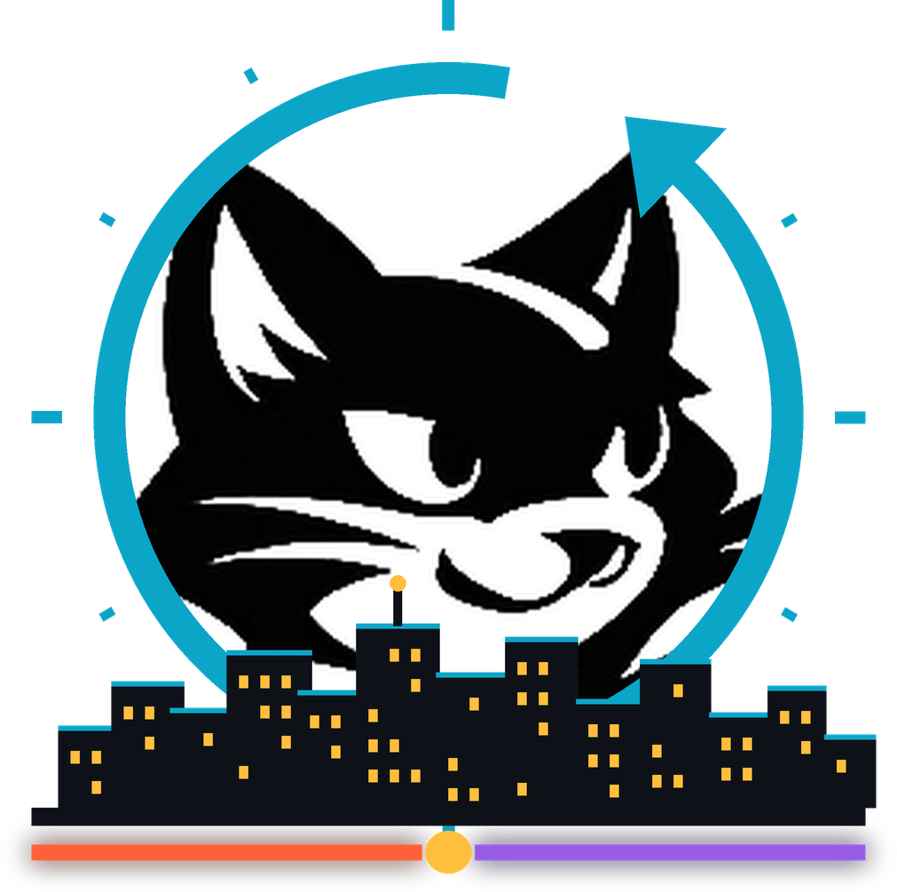
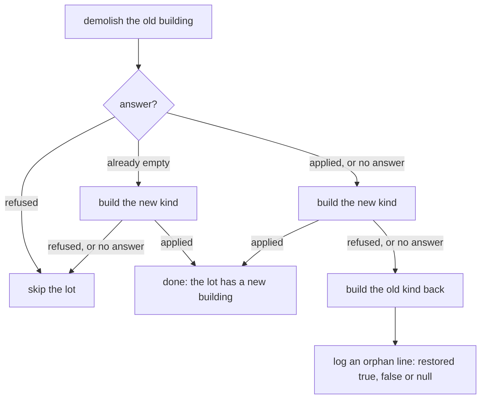

<p align="center"></p>

# Felix Metro

A 3D city simulator that runs in the browser, built on
[Felix](https://github.com/GetFelix/felix). Everything that happens in the city
is stored in durable Felix streams, so you can scrub back to any earlier moment
and play forward from there.

> **Status:** a live city runs end to end.
>
> - The sim steps the city, the browser draws it live, and a city picker switches between cities.
> - Opening the city at an earlier moment works: `/?at=<tick>#harbor` draws it there, paused.
> - The timeline bar scrubs the city back through the hours it still holds. It spans at least one city day, with the
>   part after the live head dimmed. Drag the handle, or step with `←` and `→` (`Shift` for an hour).
> - A settings button under the clock chooses the quality (Automatic, High, Medium or Low), `?` lists every key and a
>   hint on a first visit points at the timeline ([docs/ui.md](docs/ui.md)).
> - Space plays forward from an earlier moment at the city's speed, and `J`, `K` and `L` rewind, stop and speed it up
>   (see [Playing the past](#playing-the-past)). Back to live races to the live city and joins it with no gap and no
>   reload.
> - A sound button under the clock (or `M`) plays an ambient bed that follows the hour: traffic by day, crickets at night,
>   and a whoosh when you go back in time. It is off until you turn it on (see [Sound](#sound)).
> - Builders change the city through its command stream: the sim applies `build` and `demolish`, each building rises
>   in a scaffold or falls in dust, and `dev/builder-bot.mjs` grows a neighbourhood on each city's development area.
> - The page has its own building tools: the build and demolish buttons under the clock (or `B` and `X`) put a building
>   on the cleared ground and take it down, for a sign-in that may build, in the live city (see [Building](#building)).
> - The sim resumes a city from its log after a restart.
> - A share button under the settings button copies a link to the moment and view on screen; `H` hides every control for
>   a clean picture, and a page left alone for a minute turns slowly (see [Moments](#moments)).
> - Click a car or walker to follow them: the camera tracks them and a card shows their name, what they are doing
>   and their day (see [Following a resident](#following-a-resident)).
> - Not built yet: placing roads and zones.
>
> The [style frame](prototype/style-frame.html) shows the look. The plan is in
> [docs/design.md](docs/design.md) and the work is tracked in
> [milestones](https://github.com/GetFelix/felix-metro/milestones).

| Day                                                                          | Night                                                                           |
| ---------------------------------------------------------------------------- | ------------------------------------------------------------------------------- |
|  |  |

## What you will be able to do

- Look around the city: turn, tilt, slide and zoom with a mouse, trackpad, touch or the keyboard (see [Camera controls](#camera-controls))
- Watch a generated city go about its day in 3D: residents commute, shop and go home, and the sun rises and sets. Rush hour at 08:00 and 17:15 puts about 23 to 29 cars and 24 to 36 walkers on the streets of the busiest district, and about 70 cars and 70 walkers across the harbor city at 2 by 2 (522 residents; `cargo run --release -p felix-metro-core --example density -- harbor 2` prints the counts). The log is small: extrapolated to 20,000 residents in 16 districts (nothing that size has run), it averages 5.1 KB/s over a day and writes 9.96 KB/s in the busiest minute of the rush, just under the 10 KB/s goal, at 4 ticks a second. That is scaled from the measured harbor city of 522 residents in 4 districts, which averages 449 B/s, and from a city of 5,568 residents. The figure counts a record header of 22 bytes, the most it reaches (it is 16 on a young log). `cargo test -p felix-metro-sim --release report_load -- --ignored --nocapture` prints it, and `docs/design.md` has the arithmetic.
- Drag the timeline back to any moment the log holds and see the city exactly as it was
- Let go and watch it play forward and catch up to live, or rewind an evening and watch it run backwards
- Follow one resident or car through their day
- Place roads, zones and buildings, with every change recorded with who made it (buildings and demolishing work today, see [Building](#building); roads and zones do not yet)
- Fork the city at a past moment and compare the two timelines side by side

## Felix features it uses

| Need                                          | Felix feature                                              |
| --------------------------------------------- | ---------------------------------------------------------- |
| A district's history, in order                | A durable stream, one shard per district                   |
| Each tick written atomically, with its offset | `commit` on the district's shard (`commit_if_on_shard`)    |
| Only one simulation writes a city             | `publish_if` / `commit` expected offset                    |
| The newest keyframe                           | Stream state (`state_get`)                                 |
| Loading a past moment                         | Bounded range reads (`read`)                               |
| Playing forward into live                     | Subscribe from an offset, with no gap                      |
| Browsers                                      | [felix-gateway](https://github.com/GetFelix/felix-gateway) |
| Who built what                                | Sender stamp on the command stream                         |

## How it works

A simulation process steps every district of a city in ticks of 15 seconds of
city time, four a second at normal speed, so a city day takes 24 minutes. It can
be paused or run at 2× and 4×. Each tick it commits one record per district with that
tick's events, such as a resident leaving home on a route or a building going
up. It does not write positions. The browser moves cars along their routes
itself. Every city hour each district also commits a keyframe, its full state.

To show an earlier moment, the browser reads each district's nearest keyframe
and the events after it, up to that moment. To play forward, it subscribes from
there. [docs/design.md](docs/design.md) has the details.

## City stats

Press `C`, or switch on **City stats** in the settings sheet, for a panel on the left edge. It shows the residents, how
many of them are on the road (in cars and on foot) and the buildings by kind: homes, shops and offices, towers and
factories. The numbers are for the moment on screen, so they change as you drag the timeline, rewind or open a link
made with **Share this moment**. Hide the panel with `C` again; the page remembers the choice. A page opened with
`?live=0` has no residents to count, so it shows only the buildings of the generated city. [docs/design.md](docs/design.md#city-stats)
says how the numbers are worked out.

## Playing the past

Once the timeline has taken the city back to an earlier moment, three keys play it. They work like the shuttle keys of
a video editor: `L` goes faster forward, `J` goes slower or backward, and `K` stops.

| Key     | What it does                                                                                                 |
| ------- | ------------------------------------------------------------------------------------------------------------ |
| `L`     | Play forward at 1x. Each press after that doubles the speed, up to 8x. While rewinding, it slows the rewind. |
| `J`     | Rewind at 1x. Each press after that doubles the speed, up to 8x. While playing forward, it slows the play.   |
| `K`     | Stop. Space starts again at the speed you left.                                                              |
| `Space` | Play or pause, as before.                                                                                    |

Speeds run 8x, 4x, 2x, 1x backward, then stop, then 0.5x, 1x, 2x, 4x, 8x forward, and 1x is the city's own speed. The
status line next to the Play button names any speed other than 1x forward, such as `4x` or `Rewind 2x`. Pressing `J`
on the live city steps back 15 minutes and starts rewinding from there. Rewinding stops at the oldest moment the log
still holds, with a note. The keys are ignored while you type in a field or hold Ctrl, Cmd or Alt. They need a live
connection, so a page opened with `?at` cannot play or rewind.

## Sound

The page has an optional ambient sound. It is off until you turn it on: nothing plays on its own.

- Click the speaker button under the clock, or press `M`, to turn it on or off. The button shows a cross while the
  sound is off. Your choice is kept in this browser. Browsers only let a page make sound after a click or key press, so
  if you left it on, it starts again at your first click or key press on the next visit.
- By day you hear traffic. As the lamps come on it fades into crickets, and back again at dawn. The mix follows the
  city's clock, so it changes when you go back in time too.
- Going back in time, with `J` or by dragging the timeline into the past, plays a short whoosh.
- If the browser has no audio or blocks it, the button stays off and a short note says so.

The sound is made in the browser with the Web Audio API, so there are no audio files to download. The button is not
shown with `?ui=0` or `?capture`. [docs/ui.md](docs/ui.md#sound) explains how it works.

## Building

A builder changes the city from the page. The buttons under the clock are **Build** and **Demolish**, and each has a key.

| Key        | What it does                                                        |
| ---------- | ------------------------------------------------------------------- |
| `B`        | Pick the build tool, or put it away                                 |
| `X`        | Pick the demolish tool, or put it away                              |
| `R`        | Turn the building a quarter turn (it faces its street until you do) |
| `[` or `,` | Choose the previous building                                        |
| `]` or `.` | Choose the next building                                            |
| `Esc`      | Put the tool away                                                   |

With a tool picked, a panel under the buttons lists the buildings to choose from (houses, commercial buildings,
skyscrapers and factories) and a ghost of the building follows the pointer, snapped to the lot under it. The ghost is
cyan where the building fits and red where it does not. Click, or tap on a touch screen, to place it. A touch demolish takes two taps, one to pick the building and one to confirm. A demolish
shows a box round the building under the pointer. The panel then says what became of the command, in plain words:
`Built.`, `Taken down.`, or why the city turned it down. The building itself rises in its scaffold when the sim
applies the command, like any other.

Building is limited to the cleared ground: the development area every city sets aside, where no resident goes. These
are the sim's own rules, which the page checks too, so a click the sim would turn down is turned away at once. The buttons are off, with a
short note saying why, when:

- the page has no live city (`?live=0`, a city opened at a moment with `?at`, or no gateway), or you are looking at an
  earlier moment. Go back to live;
- the sign-in may only watch. The stand-in sign-in of the dev stack signs in as `viewer`, who cannot build; open
  `/?as=mayor#harbor` in a new tab to sign in as `mayor`, who can. The `?as` parameter only picks which login the dev
  stack's stand-in identity provider gives you. It grants nothing, and a real provider ignores it. A tab that is already
  signed in keeps its token, so use a new tab to change who you are;
- the connection to the city is down.

The tools do not exist under `?ui=0` or `?capture`. Roads and zones are not built here: a road changes the graph that
every route and the page's own copy of the city are built from, and a zone has no record in the log yet. They are the
next step; [docs/design.md](docs/design.md#commands-and-the-registry) lists what the sim needs.

`web/scripts/check-placement.mjs` checks the tools in CI against the dev stack: a `mayor` page using the mouse and an
`architect` page using touch build on different lots at once and each sees both buildings, two builds on one lot
leave one building and tell the loser why, and a page held at an earlier moment has the tools off until Back to live.

## Status

| M   | Milestone           | State                                                                                                                                                                                                                                                                                                                                                                                                                                                                                                                                                             |
| --- | ------------------- | ----------------------------------------------------------------------------------------------------------------------------------------------------------------------------------------------------------------------------------------------------------------------------------------------------------------------------------------------------------------------------------------------------------------------------------------------------------------------------------------------------------------------------------------------------------------- |
| 0   | The look, locked    | In progress: style frame, assets, daylight, post-processing, quality tiers, the UI shell (settings sheet, key list, first-visit hint, rolling clock), camera controls, instanced traffic and ambient life done                                                                                                                                                                                                                                                                                                                                                    |
| 1   | A live city         | Done                                                                                                                                                                                                                                                                                                                                                                                                                                                                                                                                                              |
| 2   | Time travel         | In progress: keyframes, seeking, the timeline scrubber, rewind then follow, and backward playback with speeds built, smoothness not yet measured                                                                                                                                                                                                                                                                                                                                                                                                                  |
| 3   | Follow a life       | In progress: click a car or walker to follow them, with a card for their day and a `?follow=` link; ambient sound built; city stats at any tick built; markers for notable events are not built yet                                                                                                                                                                                                                                                                                                                                                               |
| 4   | Build               | In progress: the sim applies build, demolish and speed commands and records who sent them and who built what, and the page animates a building going up (scaffold) or coming down (dust) over 8 ticks, backwards when you rewind, and says who built a building when you point at it; build and demolish tools in the page; roads and zones are not built yet                                                                                                                                                                                                     |
| 5   | Branching timelines | Planned                                                                                                                                                                                                                                                                                                                                                                                                                                                                                                                                                           |
| 6   | Scale and failover  | In progress: a restarted sim resumes from its log; 20,000 residents, 16 districts and broker loss are open                                                                                                                                                                                                                                                                                                                                                                                                                                                        |
| 7   | Self-hosting        | Planned                                                                                                                                                                                                                                                                                                                                                                                                                                                                                                                                                           |
| 8   | A first chapter     | In progress: the sim resumes from its log after a restart (nothing built is lost, no tick repeated or missing, commands run once); the city has funds (taxes and upkeep each day, a price on building, shown on the page, also for the moment you scrub to); the council's three factions are scored each city day and shown with their demands and a recall countdown; the mayor can set shop hours and speed limits for avenues and streets, each once a city day (a `policy` command); goals and investigations are planned (see [docs/game.md](docs/game.md)) |

What runs today: the sim, which picks up where it left off after a restart, the dev stack and a browser page that shows a city live, with
cars and walkers moving in time with the sim and the sun following the tick. They are drawn as instances
of their models, so draw calls do not grow with the number on the road ([how](docs/art.md#cars-and-walkers)). The page
opens on a loading screen that fills in district by district, then drifts down onto the
city. If the connection drops, a `Reconnecting…` pill shows, the city keeps moving, and
the page reads what it missed from the log and carries on in order. If retention has
already dropped what it missed, it restarts that district from the newest keyframe left.
A city the gateway refuses (a misspelled name, or no access) shows a message instead of
retrying. The city name in the top left opens a list of every city. The clock's digits roll as time moves, the button under it opens the settings sheet, and the `?` key opens the key list. The page's
own [building tools](#building) place and demolish buildings; a command published to the city's command stream by any client with a
builder's token is applied by the sim and shows up in the page, rising over 8 ticks of city time inside a scaffold (a demolished building scales down in a puff of dust). Rewind through it and it comes down again; the low quality tier skips the scaffold and the dust.

## Who built what

Point at a building and a small card says who built it and when: "Built by Ana · Day 2, 09:12 · See it go up". Your
own buildings read "Built by you". A building that was in the city from the start reads "Here since the start". On a
phone, tap the building instead. The card does not show with `?ui=0`.

"See it go up" takes the city back to 30 city seconds before the building was built and plays it forward, so you
watch it rise in its scaffold. It uses the timeline, so it needs the live connection to play; a page opened at a moment with
`?at` goes to that moment and stays paused. If the building is older than the log keeps, a note says so.

The sim records who built each building as an `author` event on every keyframe tick, so the card works for a page that
joined the city live or jumped back in time. [docs/design.md](docs/design.md#who-built-what) has the details and
[docs/ui.md](docs/ui.md) the card.

## Ambient life

Beyond the residents in the log, the city has a little life of its own: shop windows light while a shop is open (07:30 to
22:00, each shop at its own hour), factory stacks smoke on work hours, birds sit on some roofs at dawn, traffic lights
change at the crossroads, a garbage truck does a round in the morning, and delivery vans work the shopping streets by
day. The sim does not log any of it. The page draws each from the tick on screen and the city's seed, so a seek or a
rewind shows the right picture at once and the same tick always looks the same. The low quality tier keeps only the shop
windows. [docs/art.md](docs/art.md#ambient-life) has the details and what it costs; `web/scripts/check-ambient.mjs`
checks it in CI.

## Camera controls

Drag to turn the view, scroll to zoom toward the pointer, and slide with the right button or Shift. The view stays inside the city.

| Input                                            | What it does                            |
| ------------------------------------------------ | --------------------------------------- |
| Mouse: left-drag                                 | Turn and tilt the view                  |
| Mouse: right-drag, or Shift and drag             | Slide the view across the city          |
| Mouse wheel, trackpad pinch or two-finger scroll | Zoom toward the point under the pointer |
| Touch: one finger                                | Turn and tilt                           |
| Touch: two fingers                               | Slide, and pinch to zoom                |
| Keyboard: `W` `A` `S` `D`                        | Slide forward, left, back and right     |
| Keyboard: `Q` `E`                                | Turn left and right                     |
| Keyboard: `+` `-`                                | Zoom in and out                         |
| Keyboard: `0`                                    | Back to the view the page opened on     |

The arrow keys and Space belong to the timeline, and keys typed into a text field are left alone.
[docs/art.md](docs/art.md#camera) explains how the camera works and the calls the rest of the page uses to move it.

## Moments

The **Share this moment** button (the link icon under the settings button) copies a link that opens the city at the tick
on screen, seen from the camera's view. The link looks like this, and it needs a gateway to read the past:

```text
http://localhost:5173/?at=18400&cam=3.2,-1.5,22,0.785,0.9#harbor
```

`at` is the city tick, paused as for any earlier moment, and `cam` is where the camera stands:
`x,z,distance,azimuth,polar`. A link made while following a resident ends in `&follow=<resident number>` too, and opens with
the camera on them ([Following a resident](#following-a-resident)). The camera is held inside the city's limits, so a link opened with a different `districts` or
`layout` shows the nearest view it allows. The link keeps the city (the hash, `districts`, `layout` and `gateway`) and leaves out the rest of your visit.
If the log no longer holds the tick, the page says so and shows the city live.

Press `H` for photo mode: every control, the tip and the messages go away until you press `H` or `Esc`. The camera and
playback keys still work. A touch screen has no `H`, so reload to leave it.

A page nobody has touched for 60 seconds turns the camera slowly, for a display left running. Any mouse move, click,
scroll, touch or key stops it. `?attract=30` changes the wait, `?attract=0` turns it off, and it is also off with
reduced motion.

## Following a resident

Click a car or walker (tap on a touch screen) to follow them, or press `F` to follow the one nearest the middle of the view. The camera eases in and tracks them as they drive or
walk, and a card under the city name shows who they are:

- their name and kind: office worker, shift worker, shopkeeper, student, retiree or night worker;
- what they are doing now, such as `Driving to work`, `Walking to the shops`, `At school` or `Asleep at home`;
- their day, a list of where they spend it and when they leave each place. The block they are in is highlighted.

When they go indoors the camera stays on their building, and the card says what they are doing there. Turning and
zooming keep the follow. `Esc` (when no menu is open), the card's close button, or moving the view (right-drag, Shift-drag, two fingers,
`W` `A` `S` `D` or `0`) lets go. Following carries through seeks, scrubs and rewinds: drag the timeline back and the card
and camera show where they were at that moment. The **Share this moment** link includes `follow=<resident number>`;
open `/?follow=412#harbor` to start on resident 412 (residents are numbered from 0, and the harbor city has 522; a number
the city does not have shows a message). [docs/design.md](docs/design.md#following-a-resident) says how the page finds them each frame.

## Recording the clip

`web/scripts/clip-local.mjs` records it on this machine's GPU. It takes the backend from a
release bundle in Podman (nothing is built), serves this checkout's page with Vite, draws
the city in a visible Edge window one frame at a time and encodes the frames with ffmpeg:

```
cd web && npm run core
node scripts/clip-local.mjs harbor 30 ~/clips      # city, seconds, output directory
CLIP_SIM=native node scripts/clip-local.mjs ...    # this checkout's sim in place of the bundle's image
```

The page draws frame by frame only under `?capture&trace`, with the camera and the city's
tick following a path the script sets, so the clip is smooth however long a frame takes. The
shots are the street at rush hour, the evening coming on, the timeline dragged back to the
morning, played forward and back to live. A playback is stepped one video frame at a time
in capture mode, so the clip does not depend on how long a frame takes to draw. `density.json` and `shots.csv` count the cars and walkers drawn. Everything
the script starts is stopped when it ends. The sim has to be native (`CLIP_SIM=native`)
for any sim change that is not in the release bundle's image.

The bundle's ports are moved so it runs beside another Felix stack: broker 5100/udp, 28080,
18443, and the gateway on `CLIP_GATEWAY_PORT` (default 18787, which Vite proxies through
`FELIX_GATEWAY_PORT`). The native sim's control address is `CLIP_SIM_PORT` (default 18090).
The run stops if 5173 is already in use. It runs as its own compose project, `felix-metro-clip`, so its cleanup never
removes a felix-metro stack you started yourself; stop that stack first, since both use 8088 and 9400.

The Clip workflow (`.github/workflows/clip.yml`, run by hand) does the same on a CI runner in
software GL, as a fallback; it fails when no mp4 is written. `cargo run --release --example
density -- harbor 2` in `core/` prints the cars and walkers on the road from the schedules alone.

## Install a release

Each [release](https://github.com/GetFelix/felix-metro/releases) has a compose bundle
that pulls the published images instead of building them. You need Docker or Podman as
described below. The compose bundle runs Felix 0.6.2.

```sh
curl -fsSL https://github.com/GetFelix/felix-metro/releases/download/v0.2.2/felix-metro-compose-0.2.2.tar.gz | tar xz
cd felix-metro-compose-0.2.2
./up.sh
```

It starts the same stack as `dev/up.sh` and returns once the cities are serving. The web
app is at <http://127.0.0.1:8088>. `./speed.sh` and `./city.sh` work as the `dev/` ones
do. `SHA256SUMS` on the release lists a checksum for each download, and
`felix-metro-web-v0.2.2.tar.gz` is the built web app alone.

## Run it locally

You need Docker or Podman (`podman compose` with Docker Compose v2 or podman-compose
1.4 or later as its provider; on macOS run `podman machine start` first).

```sh
dev/up.sh
```

The first run builds the sim and the web app, which takes a few minutes. It starts
Felix (a control plane and one broker as a cluster of one, so a city's stream can
have a shard per district), a stand-in sign-in provider, the
[gateway](https://github.com/GetFelix/felix-gateway), the sim and the web app, with the
cities `harbor` and `pinecrest` (and `lakeside`, which the sim holds back, see below). It returns once a probe has seen a tick on every
district of both cities arrive through the gateway, and prints the web app's address,
<http://127.0.0.1:8088>. The stack keeps no state between runs: `dev/up.sh` starts it
over each time. Stop it with `docker compose -f dev/compose.yml down --volumes`
(`podman compose` the same).

Open <http://127.0.0.1:8088/#harbor>: the page signs in as `viewer` at the stand-in
provider (open it in a new tab with `?as=mayor`, as in <http://127.0.0.1:8088/?as=mayor#harbor>, to sign in as the builder instead; see [Building](#building)), follows the city through the gateway and draws its residents driving and
walking in time with the sim, with the sun following the tick. A new city
first commits a day and a half of ticks in a few seconds (`SIM_WARMUP_HOURS`, 40 by default),
so it opens in the late afternoon of its second day with a day behind it to scrub through and
the evening commute under way; `dev/up.sh` returns once that is done. Run `dev/speed.sh harbor 16`
to move faster. Without a gateway the page draws the city alone.

Click the city name in the top left to switch cities, or open `/#pinecrest` (any name
in the list) directly. Choosing a city opens its page afresh, so the old city's
connections close with the old page. The list comes from the registry, which the sim
writes to as each city starts, so a city that starts while the page is open appears in the
list without a reload (a city started again at another size is listed at the latest one).
If a city cannot open its streams when you start it, `dev/city.sh` fails with the reason
and the sim keeps running. The stack seeds a third city, `lakeside`, and the sim keeps it idle
and unlisted until you start it:

```sh
dev/city.sh lakeside
```

A page opened at a city the gateway refuses (`/#nowhere`) still shows the list. It reads
it through `lobby`, a city the stack seeds for that and nothing else: no sim, no
builders, never listed. Everyone who signs in may join it.

To see the page ride out a dropped connection, stop the gateway for a few seconds and
start it again (the page shows `Reconnecting…` and carries on):

```sh
dev/gateway.sh stop
dev/gateway.sh start
```

`dev/gateway.sh recreate` brings the gateway back at a new address instead; the web
container looks the name up again, so the page reconnects through it.

To watch ticks arrive the way a browser gets them, through the gateway (needs Node 22):

```sh
node dev/check-ticks.mjs harbor pinecrest
```

To build the way a mayor does, from a plain client with no browser (needs Node 22), publish
commands through the gateway and watch them come back as events:

```sh
node dev/check-commands.mjs pinecrest
```

It signs in as `mayor` (`GET /token?sub=mayor` on the dev IdP, no `Origin` header),
publishes `build` commands until one takes, and checks that the district of that lot
records the command with its sender and the `built` event within a tick. It then sends
commands the sim must refuse and checks each is recorded with its reason and changes
nothing. It then waits for the district's next keyframe (up to a minute at the default speed)
and checks it lists the built lot, and demolishes what it built. A `viewer` cannot publish.

### Growing a neighbourhood

`dev/builder-bot.mjs` builds the way a mayor does, for demos and the clip. Start the stack with `dev/up.sh`
first. The bot needs Node 22, and `cargo` to read the city's layout unless you pass `--city-file`.

```sh
node dev/builder-bot.mjs pinecrest --interval 2 --count 12 --json bot.ndjson
```

`pinecrest` is the city to build in. The bot signs in as `mayor`, sends a probe command and waits for its result
(commands sent before the sim opens its subscription are lost), then raises 12 buildings in one district, one every
2 seconds, and writes a line of JSON for each command to `bot.ndjson`. Homes go on suburban land, shops on corners
and arterials, offices toward the centre of town and factories on industrial land.

**Where it builds.** Almost every lot is one residents go to, and the sim refuses to change those. Each city
therefore sets aside a development area: 14 to 16 empty lots in one district (14 in `harbor`, 15 in `pinecrest`
at 2 by 2) that no resident visits, drawn as bare earth until something is built. The bot gets the layout from the
core crate's `city_json` example and builds on the development area first, from its middle outwards, with the same
rules as elsewhere (homes preferred on suburban lots). A city of one district (`--side 1`) has a smaller area: 5
lots in `harbor`, 12 in `pinecrest` and 4 in `lakeside`. Once those are built on, the bot moves to the other empty
lots of the district.

**What it reads back.** Every command's result is read. A refusal (in use, occupied, busy, unsupported) moves on to
the next lot, and the bot never goes back to a lot. A command that gets no result within `--result-timeout` counts
as lost.

**Lots that hold a building.** By default these are skipped. With `--rebuild` the bot demolishes the building and
builds a new one in its place. Between the two the lot is bare, so the bot keeps track of it:



"Already empty" means an earlier run took the building down. The bot builds there, and if that fails the lot stays
bare with no orphan line, because this run demolished nothing.

A demolish with no answer is treated as applied, because the sim may have applied it and the answer been lost. If
the build is then refused, the old kind is built back. The bot writes an `orphan` line to the JSON log (and a
message to stderr) saying how that went. Its `restored` is `true` when the old building stands again (the restore
was applied, or refused because the lot was never emptied), `false` when the restore was refused, and `null` when
it got no answer or the bot exited mid-turn (a second signal, or an error).
`dev/check-builder-bot.mjs` fails on any orphan that is not `true`.

| Flag                   | Default                                                                    |                                                                                   |
| ---------------------- | -------------------------------------------------------------------------- | --------------------------------------------------------------------------------- |
| `--interval <s>`       | 2                                                                          | wall seconds after each build that took                                           |
| `--count <n>`          | 12                                                                         | buildings to raise before stopping                                                |
| `--district <n>`       | the development area's, else the district with the most lots it may change | where to grow                                                                     |
| `--centre <x,z>`       | the middle of the development area, else the densest spot of such lots     | tile to grow around                                                               |
| `--rebuild`            | off                                                                        | also demolish and rebuild lots that hold a building                               |
| `--demolish-after <s>` | off                                                                        | once done, wait this long and take buildings down again, newest first             |
| `--demolish <n>`       | 3                                                                          | how many to take down                                                             |
| `--json <path or ->`   | off                                                                        | a line of JSON for the start, each command with its tick, any orphan, and the end |
| `--side <n>`           | 2 (the square root of `DISTRICTS`)                                         | districts a side of the city has; the sim's default                               |
| `--city-file <path>`   | run the example                                                            | the example's output, saved                                                       |
| `--result-timeout <s>` | 30                                                                         | how long a command may go unanswered before it counts as lost                     |

SIGINT or SIGTERM stops after the lot the bot is working on and writes the end line, which carries the mean tile of
what was built for aiming a camera. A second signal exits at once, still writing it. The bot exits 1 if a command got
no result or nothing was built. It places no roads; the sim refuses them. CI runs it for about 20 seconds and checks
the log with `dev/check-builder-bot.mjs`, which counts only net new buildings (a build applied on a lot that was
empty, with no demolish applied on it first) and wants at least ten in one district.

To see the sim carry on from its log, restart it alone. The broker keeps the log, so each city goes on from the next
tick with every building and everyone where they were:

```sh
docker compose -f dev/compose.yml restart sim   # podman compose the same
docker compose -f dev/compose.yml logs sim | grep "resumed from its log"
```

The page keeps drawing and picks up when the sim is back. A command sent while the sim is down runs when it returns,
and none runs twice. [sim/README.md](sim/README.md#restart) has the details. `dev/check-restart.mjs` checks this through
the gateway: run `node dev/check-restart.mjs before pinecrest`, stop the sim, run `offline`, start the sim and run `after`
(CI does the same).

The sim runs at 4 ticks a second. Its speed endpoint accepts only loopback, so it is
not published; `dev/speed.sh` runs `curl` inside the sim's container:

```sh
dev/speed.sh harbor 16   # 0 pauses, 4, 8 or 16
dev/speed.sh harbor      # show it
```

`dev/seed.mjs` sets up the tenant, each city's streams and `lobby`, and the roles that
`viewer` (watch) and `mayor` (watch and build) sign in with. `METRO_BUILDERS=mayor,architect dev/up.sh` makes a
second sign-in a builder too, which CI uses to test two builders at once. `sim/ci/` runs the same
seed against a broker for the sim's integration test.

## Documentation

- [docs/design.md](docs/design.md): the design, data model and build order
- [docs/art.md](docs/art.md): art direction, the asset packs and the style frame
- [docs/ui.md](docs/ui.md): the page overlay: settings sheet, key list, and the kit and rules for new controls
- [docs/game.md](docs/game.md): draft of what makes it a game: money, policy, goals, investigations, what-ifs
- [Felix docs](https://docs.getfelix.dev/)

## Felix version

The Felix release this repo builds on is in [`.felix-version`](.felix-version).
When Felix publishes a release, a bot opens a "chore: use Felix <version>" PR
that moves every pin listed in [`.github/felix-bump.sh`](.github/felix-bump.sh)
and the lockfiles, and merges it once CI passes. Prereleases are skipped.

Every night a workflow
([`felix-nightly.yml`](.github/workflows/felix-nightly.yml)) points the Felix
crates listed in `.felix-version` at the commit behind Felix's `nightly` tag and
runs [`.github/felix-nightly.sh`](.github/felix-nightly.sh): it starts the sim's
test stack and the dev stack from the `:nightly` Felix images, runs a city for a
day, and runs the dev-stack checks that need no browser. When a run on `main`
fails it opens an issue labelled `felix-nightly`, and a green run closes it, so
a Felix change that breaks this repo shows up before the next release. See the
latest run with `gh run list -R GetFelix/felix-metro --workflow "Felix nightly"
--limit 1`, or start one from the Actions tab.

The gateway is pinned on its own, by image tag in [`dev/compose.yml`](dev/compose.yml) (0.8.0 today). Move that tag
when a gateway release adds something the page needs.

## Contributing

See [CONTRIBUTING.md](CONTRIBUTING.md).

## License

MIT. See [LICENSE](LICENSE).
