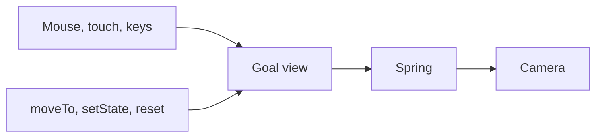
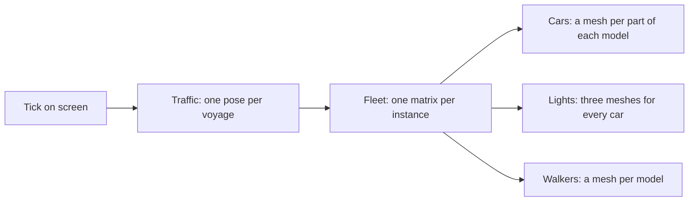

# Art direction

Felix Metro is a model city on a table: low-poly, saturated, seen from above
through a tilt-shift lens, with the time of day doing most of the mood. The
reference is [prototype/style-frame.html](../prototype/style-frame.html).

| Noon | Golden hour | Night |
|---|---|---|
|  |  |  |

## Assets

Six Kenney packs, all CC0 and one family. They share Kenney's gradient-swatch
palette and proportions, so they sit together without restyling by hand.

| Pack | Used for | Notes |
|---|---|---|
| City Kit (Roads) | Roads, crossings, pavement lots, street lights, traffic lights | Tiles are 1 × 1 units; the grid is built on them. `road-straight` runs along X |
| City Kit (Commercial) | Downtown and commercial lots, towers | 14 buildings, 5 towers, awnings and parasols |
| City Kit (Suburban) | Houses, trees, fences, driveways | Also the source of every tree |
| City Kit (Industrial) | Factories, tanks, chimneys, containers, water tower | |
| Car Kit | Traffic | Sedan, taxi, SUV, van, delivery, police, ambulance, trucks; scaled to 0.12 |
| Mini Characters | Pedestrians | Rigged, with `walk`, `idle`, `sit` and more; scaled to 0.17 in the style frame and 0.22 in a city |

Considered and left out:

- **Nature Kit**: an older, flat-coloured style that does not match the city kits. Trees come from the suburban pack.
- **Anything not Kenney**: mixing families is how low-poly scenes end up looking like asset flips.

Gaps for later milestones: no buses or trams, no parks furniture beyond parasols.
Construction has no models of its own; see [Construction](#construction).

## Asset pipeline

`web/src/assets.ts` globs every GLB under `prototype/assets/models`, so a model is addressed by pack (folder) and file name and a new file needs no code. `models.ts` loads each file once and clones it per placement. `materials.ts` builds the colormap variants and the window mask once per pack and shares materials by pack, variant and light level. `web/models.html` loads every model and runs in CI.

## Rules

- **Colour comes from recoloured colormaps.** Every model of a pack samples one 512 × 512 `colormap.png`. The default has white walls and green roofs; a building's look is a variant of that texture with its wall swatches (bright, unsaturated) and roof swatches (green) tinted from the palette lists in the style frame. Windows, trims and roads keep Kenney's colours.
- **Lit windows come from the same texture.** The colormap's light-blue swatches are windows; a mask of them is the emissive map, scaled by how dark it is. Towers use a lower level because their glass is one large swatch.
- **Light pools are decals.** Street lights and headlights are additive sprites and ground decals, not real lights, so hundreds cost almost nothing. They are hidden from the ambient occlusion pass.
- **Time of day is one function.** Sky, fog, sun, hemisphere light, exposure, window light, lamps and headlights all come from the hour (`web/src/daylight.ts`). Each building starts lighting its windows at its own fixed time between 17:30 and 19:30 and starts to darken between 06:00 and 07:30, each fade taking ten minutes, so the last are done by 19:40 and 07:40. Each street lamp switches on at its own time between 18:27 and 18:47 and fades out at dawn between 06:54 and 07:14, nine minutes either way. Both come from a hash of position, so the same moment always looks the same. The sun sets in the west (+x), on the camera's side, so evening light falls on the faces in view.
- **Post processing**, in order: ambient occlusion (high tier only, see [Quality tiers](#quality-tiers)), bloom with a threshold of 1 so only lights glow, distance blur, tone mapping, then a small saturation lift and vignette. The blur is by depth and only on the far side: nothing in front of the focus plane through the orbit target is blurred, a sharp band as wide as the camera distance follows it, and a gentle haze grows from there toward the horizon. A tall building in the band stays sharp to its roof.
- **Buildings fit their lot.** Some Kenney buildings are wider than a tile, so each is scaled down to fit 0.9 of its lot and none overlap.
- **Brand**: Inter and JetBrains Mono, cyan `hsl(192, 90%, 46%)` for Felix accents, amber for light, and coral to violet for the timeline. The Felix tower downtown carries the mark. The overlay's palette tokens, glass panels, type and motion are in [ui.md](ui.md).

## Using the style frame

Serve the repository root (`python3 -m http.server`) and open
`/prototype/style-frame.html`. Parameters:

| Parameter | Effect |
|---|---|
| `?t=17.8` | Freeze the clock at that hour |
| `?still` | Freeze cars and people, for screenshots |
| `?tier=low\|medium\|high` | Force a quality tier and turn off the automatic choice |
| `?hud` | Frame-time overlay under the brand chip |
| `?ui=0` | Hide the overlay |
| `?capture&trace` | Draw only when `window.__capture.frame(tMs)` is called, with the camera and tick following a path the clip script sets (`web/scripts/clip.mjs`) |

The app (`web/`) draws the city generated from the seed in the URL hash (`/#harbor`), 2 × 2 districts by default (`?districts=3`). `?layout=frame` draws the style frame's hand-made map instead, which is what CI compares against the frame. `?live=0` skips the gateway and draws the city with no traffic, and `?gateway=ws://host:8787/ws` names a gateway other than the page's own. `?at=<tick>` opens the city at a past tick, `?cam=x,z,distance,azimuth,polar` starts the camera at a saved view (the two make up the link that Share this moment copies) and `?attract=<seconds>` sets how long the page waits before the camera turns on its own (`0` for never).

The screenshots above are `?t=12&still`, `?t=17.8&still` and `?t=21&still` at
1600 × 900.

## Camera

You move around the city by moving the point the camera looks at, standing nearer or farther from it, or walking the camera round it. These controls work in the app, on a generated city and on the frame layout (`?layout=frame`, the style frame's hand-made map instead of a generated city). The style frame page itself (`prototype/style-frame.html`) still uses plain orbit controls.

| Input | What it does |
|---|---|
| Mouse: drag with the left button | Turn and tilt the view around the point it looks at |
| Mouse: drag with the right button, or hold Shift and drag | Slide the view across the city |
| Mouse wheel | Zoom toward the point under the pointer |
| Trackpad: click and drag | Turn and tilt, as with a mouse |
| Trackpad: hold Shift and drag | Slide the view (a trackpad has no right button) |
| Trackpad: pinch or two-finger scroll | Zoom toward the point under the pointer. Ctrl and wheel over the canvas zooms the city, not the page |
| Touch: drag with one finger | Turn and tilt |
| Touch: drag with two fingers | Slide the view |
| Touch: pinch | Zoom toward the point between the fingers |
| Keyboard: `W` `A` `S` `D` | Slide the view forward, left, back and right (hold to keep going) |
| Keyboard: `Q` `E` | Turn the view left and right |
| Keyboard: `+` `-` | Zoom in and out |
| Keyboard: `0` | Return to the city's opening view (where the drift from above settles) |

The keys are ignored while you type in a text field or hold Ctrl, Cmd or Alt, so browser shortcuts still work. The arrow keys step the timeline and Space plays, so the camera leaves them alone. The table of keys is data (`CAMERA_KEYS` in `web/src/camera-keys.ts`), and the key list in the UI builds its View and Mouse and touch groups from it and from `CAMERA_GESTURES`.

Pinch on a trackpad is checked in Chromium, where it arrives as a wheel event with Ctrl held. Safari sends it as its own gesture events instead; the page handles those the same way, but that path has not been tried in Safari.

Three limits keep the view in the city:

- **Tilt** stays between 0.5 and 1.15 radians from straight down, so the camera never goes edge-on or under the ground.
- **Distance** stays between 8 and 40 tiles on the frame layout's map, and the far limit grows with the size of a bigger city.
- **The point it looks at stays inside the map.** Zooming out and sliding as far as you like stops at the city's edge, for a 2 by 2 city and a 4 by 4 one alike. The bounds come from the generated city's size (`cityBounds` in `web/src/camera-math.ts`).

### How it works

The view is five numbers: the ground point (x, z) it looks at, the distance, and two angles (`azimuth` round the point, `polar` down from straight above). Everything you do changes a goal view, and the camera chases the goal on a critically damped spring, which arrives without bouncing. Dragging uses a quick spring. A move made by the app (`moveTo`, `setState`, `reset`) uses a slower one that takes about half a second. If the person has asked their system for reduced motion, those moves jump instead.



Zoom toward the pointer works on the ground under the pointer. The camera moves along that point's line of sight, so the point stays under the pointer while the distance changes, and the look-at point slides to match. Dragging with the right button grabs the ground in the same way, so the ground under the pointer stays under it once the view has settled (the drawn view trails the goal by a fraction of a second), and a slide covers more ground the farther out the camera is. The maths is in `web/src/camera-math.ts` with no DOM in it, and `web/src/camera.test.ts` and `web/src/camera-math.test.ts` check it, including that the ground under the pointer stays put.

The rest of the app drives the camera through three calls on the object `createCamera` returns (`controls`):

```ts
controls.moveTo({ x: 6, z: -4 }, 12, Math.PI / 4, 0.9); // ease to look at (6, -4) from 12 tiles away
const saved = JSON.stringify(controls.state()); // {"x":6,"z":-4,"distance":12,"azimuth":0.785,"polar":0.9}
controls.setState(JSON.parse(saved), { ease: false }); // jump straight back to it
```

`moveTo(target, distance, azimuth, polar, { ease })` holds every number inside the limits and turns the short way round. `state()` is where the camera is heading, rounded to three places, so a link can carry it. `setState` takes the same object back and returns false for anything else. In a dev build, or under `?trace`, the camera is on the page as `window.__camera` for trying these in the console.

The opening drift (`startIntro`) places the camera through the same object and ends when the person touches any control or the app moves the camera, so a saved view applied at load is not drifted away from. Under `?capture&trace` the controls are off and the clip script positions the camera itself, as before.

## Construction

A building takes 8 ticks (two seconds at the default speed) to go up or come down, from the tick of its `built` or
`demolished` event. Both are drawn from the tick on screen alone, so scrubbing and rewinding play them backwards.

- **Rising:** the building grows from the ground to its height and a scaffold climbs round it: a square frame of four
  posts and four rails in warm timber (`0xd9a05b`), 0.94 tiles wide, standing a little taller than the wall and settling
  to its height as the building tops out. Nothing is left once the 8 ticks are up.
- **Coming down:** the building shrinks to the ground (from the height it had, when a rise was cut short), fully opaque,
  with the same scaffold round it, while twelve grey-tan dust sprites (`0xb8b0a4`, 0.6 to 1 tile) ring the lot. The
  cloud swells to full strength at the middle of the window and thins out again, so it reads against the pale ground.
- **Cost:** the frames, dust and stand-in buildings are pools made once (24 scaffolds, 8 puffs, 24 stand-ins), nothing is
  allocated per frame, and a lot that finds a pool full goes without that effect for its whole window, so nothing pops in
  late. The low tier leaves out the scaffold and the dust and only scales the building.
- **Which tick ends it:** an animation is dropped once the tick on screen, not the newest record, is past its window, so
  records applied ahead of the picture (a gap filled, a playback timer) do not cut a building short. A live keyframe
  leaves the animations a state already follows; only a fresh fold starts with none.

`web/construction.html` draws one lot at a tick from the URL (`?mode=build|demolish&tick=104&via=forward|seek|back&tier=low`)
and `web/scripts/check-construction.mjs` compares it with `web/references/construction-rise.png` and
`construction-fall.png` in CI, and with the same lot a quarter of the way in (`-early`, tick 102) so the length of the window is pinned as well as its middle. A window of 9 ticks instead of 8 differs from the four references by 6.4%, 4.2%, 1.3% and 0.9%; the check allows 1%. They are renders of the page on software GL, so rewrite them with
`UPDATE_REFERENCES=1 node scripts/check-construction.mjs <url> <out>` after a change to the look.

The same page with `?churn` instead swaps one lot between two buildings 101 times without waiting for the models to
load, as a run of fast timeline drags does, and reports how many objects the scene holds. The check wants the count
after the burst to equal the count after a single swap: a lot is drawn once, whatever happened to it on the way.

## Cars and walkers

Every car and walker on screen stands for one voyage in the log. The page works out where each one is from the tick
alone, so scrubbing and rewinding draw the same road, and hands the poses to a fleet that draws them as instances: one
draw call per mesh, however many cars or walkers use it.



`web/src/traffic.ts` (`Traffic`) holds the maths: the lane or pavement a voyage keeps to, its heading, and the turn into
the lot at each end of a trip. It places every voyage between `fleet.begin(dt)` and `fleet.end()` and keeps nothing
between rounds, so what is drawn is exactly what the last update placed. `web/src/fleet.ts` turns those poses into
instances.

**Cars.** A car model is a body and four wheels, and on some a door, each its own mesh. The fleet makes one instanced
mesh for each part of each of the six car models, and an instance's matrix is the car's pose times the part's place in
the model. A hundred sedans draw as many times as one. Cars cast shadows, as before.

**Lights.** The two headlights and two taillights of every car, and the pool of light the headlights throw on the road,
are three instanced meshes shared by all the cars. `THREE.Sprite` cannot be instanced, so the glows are camera-facing
quads with a small shader (`glowMaterial` in `web/src/instanced.ts`) that keeps the size and fog of a sprite. How
bright they are is a uniform the time of day sets, so night falling costs no recompile.

**Walkers.** A walker's mesh is skinned to bones, and each skinned mesh carries its own, so it cannot be instanced. The
walk clip is played once per model at load and the position and normal of every vertex are stored at 20 evenly spaced
moments of the loop in a texture (`bakeWalk` in `web/src/walk.ts`). The vertex shader reads two neighbouring moments
and blends them. One clock, moved on by each frame's time, is shared by every walker, and a walker's place in the
cycle is its resident number's share of the golden ratio, so a crowd does not step together. The legs run on real
time, not on the city's tick, so a paused city still walks; `?still` freezes them.

What differs from drawing a cloned model for each:

- The fleet drops a car or walker that is more than 1.5 tiles outside the camera's view (`Fleet.view`), so what is off
  screen costs nothing. The 1.5 tiles keep a car's shadow, and the frame the camera lags behind the cars, from
  popping. What is inside the view is not culled one by one: every instance a mesh holds is drawn. Each mesh starts with
  room for 64 instances and doubles when it fills.
- Walkers cast no shadow, and they are left out of the depth pass behind the distance blur and the ambient occlusion
  pass, with the lights. Those passes draw everything with one material, which would draw a walker in its bind pose and
  leave a halo. Cars are in both passes, as before.
- A voyage that ends stops being drawn at the next `Traffic.sync` or update, so a frame with no tick still drops it.
- The style frame (`?layout=frame`) still places cloned models, so it keeps matching `prototype/style-frame.html`
  pixel for pixel.

### What it costs

`web/traffic-load.html` draws the generated city at 2 by 2 through the real post chain with N cars and walkers going
back and forth along its roads, using every car kind and every walker model, and `web/scripts/check-traffic.mjs`
prints what a frame cost for several N:

```
cd web && npm run build && npx vite preview --port 4173 &
node scripts/check-traffic.mjs http://127.0.0.1:4173/traffic-load.html high 0,100,400,800
```

It is a dev page, built into `dist` next to `models.html` and `construction.html`, and nothing links to it.

The numbers below are in headless Chromium on SwiftShader, which draws with the CPU, at 1280 by 720, on an Apple M4 Max
shared with other jobs. Draw calls are exact. "Submit" is the median ms over 20 frames the page spent in its own code
and in WebGL calls, which is what draw calls cost on a real GPU. "Frame" waits for SwiftShader to finish drawing, which
instancing does not speed up. It moved by as much as 50% between two runs of the same build with other jobs running, so
the table gives the best of two runs.

| Tier | Movers | Draw calls before | Draw calls after | Submit ms before | Submit ms after | Frame ms before | Frame ms after |
|---|---|---|---|---|---|---|---|
| high | 0 | 6,270 | 6,270 | 7.1 | 7.7 | 468 | 470 |
| high | 100 | 8,049 | 6,489 | 11.1 | 8.8 | 526 | 525 |
| high | 400 | 13,665 | 6,489 | 19.6 | 8.9 | 704 | 690 |
| high | 800 | 20,862 | 6,489 | 32.3 | 8.9 | 982 | 912 |
| medium | 0 | 4,240 | 4,240 | 5.4 | 6.0 | 267 | 264 |
| medium | 80 | 5,214 | 4,395 | 7.2 | 6.2 | 296 | 297 |
| medium | 160 | 6,180 | 4,395 | 8.9 | 5.8 | 328 | 330 |
| medium | 400 | 9,170 | 4,395 | 13.6 | 5.7 | 428 | 412 |
| low | 0 | 1,216 | 1,216 | 2.5 | 2.7 | 107 | 107 |
| low | 40 | 1,449 | 1,273 | 3.0 | 2.7 | 112 | 113 |
| low | 80 | 1,685 | 1,275 | 3.6 | 2.8 | 118 | 118 |
| low | 400 | 3,571 | 1,275 | 6.8 | 2.7 | 167 | 161 |

The 0 rows are the city alone: its buildings, roads and trees are still one object each. Before, every mover added about
18 draw calls. Now the first movers add a fixed 219 on high, 155 on medium and 59 on low (a mesh for each part of each
car model and each walker model, and the lights, in every pass the tier runs), and more movers add none. The frame time
SwiftShader needs is the same before and after within the noise, because the CPU rasterizer pays for triangles and not
for calls. The "before" numbers come from a build of the commit before this change (`a049c20`) with the same page and the old
call into `Traffic`, which is not kept in the repository; it added about 7,400 draw calls for 400 movers.

SwiftShader says nothing about a GPU's fill rate or vertex rate, so it cannot say how many cars a laptop GPU can draw.
What it shows is that the draw calls and the page's own time no longer grow with the number of movers, which is what
the old limits guarded. What still grows is the triangles each mover adds in each pass that draws it.

## Quality tiers

Each tier drops effects in the order that costs the least in looks, so the
picture degrades before the frame rate does.

| Tier | Ambient occlusion | Tilt-shift | Shadows | Pixel ratio | Cars and walkers at once | Pedestrian rigs\* |
|---|---|---|---|---|---|---|
| high | yes | yes | 4096 map | up to 2 | no limit | yes |
| medium | no | yes | 2048 map | up to 2 | 160 | no |
| low | no | no | no | 1 | 80 | no |

\* The `rigs` flag is set only on high. Rigged pedestrians arrive with #6; until then nothing reads it.

Past the limit, a voyage is left undrawn until one that is drawn arrives. `window.__live.capped` counts what is left
out (in a dev build, or under `?trace`).

The limits are twice what they were before cars and walkers were instanced, because the draw calls they were set
against are gone. They are not measured against a GPU. On SwiftShader the extra movers cost about +11 ms on low with 80
(from 107 ms with none, +10%) and +66 ms on medium with 160 (from 264 ms, +25%). A device that is too slow with a limit
steps down a tier as before, and a lower tier has a lower limit. High has no limit.

`web/src/quality.ts` chooses the tier. It starts on high and measures frame
times for the first 3 seconds after the city is ready, ignoring the first 5
frames and any time the tab is hidden. It steps down one tier when the median
is over 22 ms, or over 1.3 times the display's frame interval if that is
longer. The interval is estimated from the fastest tenth of frames and held
between 4 and 33.4 ms, so a steady 30 Hz display is not treated as slow.
After a step it rebuilds the post chain and judges another 1.5 seconds,
repeating until a window passes or it reaches low. It never steps up. A frozen
scene (`?still`) has no meaningful frame times, so it never chooses on its own
and ignores a saved tier.

A tier from `?tier=` or from a saved choice is used as it is and turns the
automatic choice off. The settings sheet (see [ui.md](ui.md)) saves a
choice through `setTier()`. Choosing Automatic there calls `setAutomatic()`,
which forgets the saved tier and judges frame times again from high. Automatic
choices are not saved: a slow first load should not pin a device to low for good.

`?hud` shows the median and 95th percentile frame time over the last 120
frames, draw calls and triangles for the last frame, and the tier with whether
it was chosen automatically, forced, or fixed because the scene is frozen.
`?slow=40` adds 40 ms to every frame so CI can exercise the step-down.
