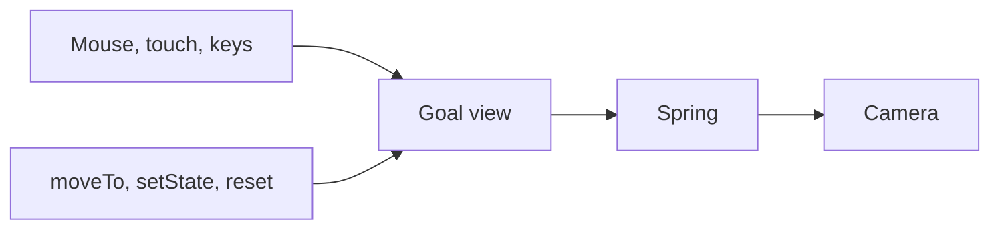
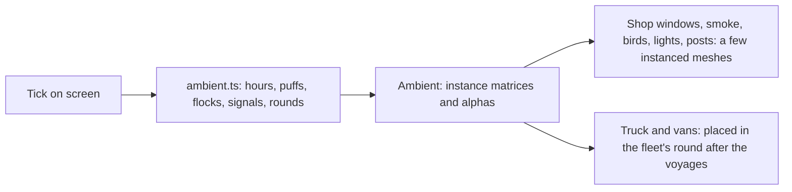
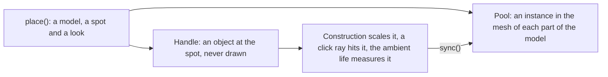
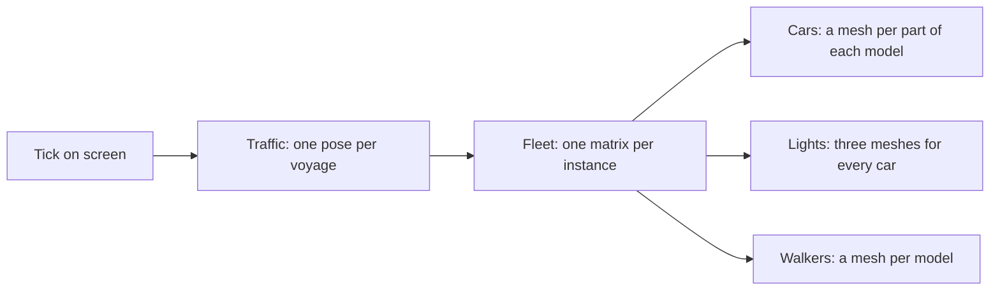
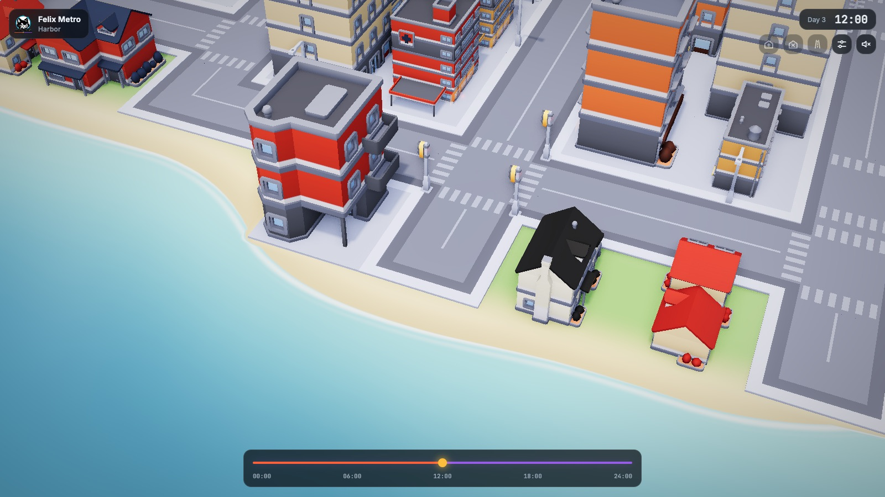
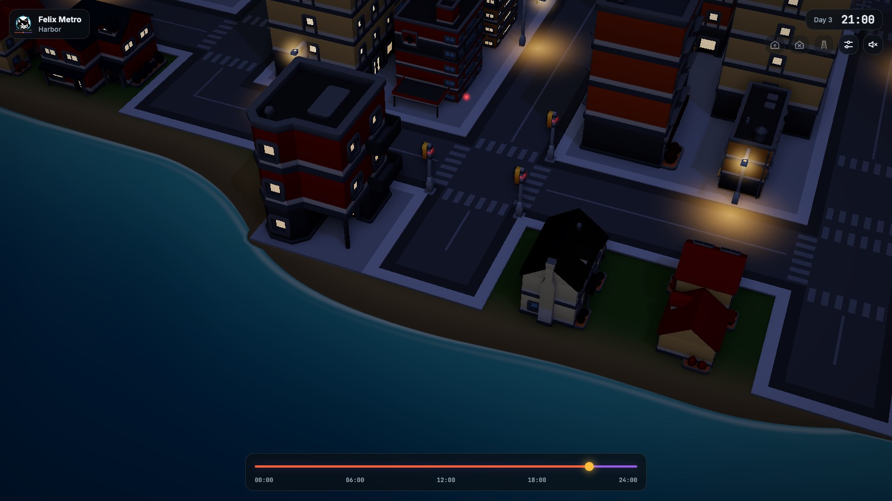

# Art direction

Felix Metro is a model city on a table: low-poly, saturated, seen from above
through a tilt-shift lens, with the time of day doing most of the mood. The
reference is [prototype/style-frame.html](../prototype/style-frame.html).

| Noon                                         | Golden hour                                                 | Night                                           |
| -------------------------------------------- | ----------------------------------------------------------- | ----------------------------------------------- |
|  |  |  |

## Assets

Six Kenney packs, all CC0 and one family. They share Kenney's gradient-swatch
palette and proportions, so they sit together without restyling by hand.

| Pack                  | Used for                                                       | Notes                                                                                             |
| --------------------- | -------------------------------------------------------------- | ------------------------------------------------------------------------------------------------- |
| City Kit (Roads)      | Roads, crossings, pavement lots, street lights, traffic lights | Tiles are 1 × 1 units; the grid is built on them. `road-straight` runs along X                    |
| City Kit (Commercial) | Downtown and commercial lots, towers                           | 14 buildings, 5 towers, awnings and parasols                                                      |
| City Kit (Suburban)   | Houses, trees, fences, driveways                               | Also the source of every tree                                                                     |
| City Kit (Industrial) | Factories, tanks, chimneys, containers, water tower            |                                                                                                   |
| Car Kit               | Traffic                                                        | Sedan, taxi, SUV, van, delivery, police, ambulance, trucks; scaled to 0.12                        |
| Mini Characters       | Pedestrians                                                    | Rigged, with `walk`, `idle`, `sit` and more; scaled to 0.17 in the style frame and 0.22 in a city |

Considered and left out:

- **Nature Kit**: an older, flat-coloured style that does not match the city kits. Trees come from the suburban pack.
- **Anything not Kenney**: mixing families is how low-poly scenes end up looking like asset flips.

Gaps for later milestones: no buses or trams, no parks furniture beyond parasols.
Construction has no models of its own; see [Construction](#construction).

## Asset pipeline

`web/src/assets.ts` globs every GLB under `prototype/assets/models`, so a model is addressed by pack (folder) and file name and a new file needs no code. `models.ts` loads each file once and clones it per placement. `materials.ts` builds the colormap variants and the window mask once per pack and shares materials by pack, variant and light level. `web/models.html` loads every model and runs in CI.

## Rules

- **Colour comes from recoloured colormaps.** Every model of a pack samples one 512 × 512 `colormap.png`. The default has white walls and green roofs; a building's look is a variant of that texture with its wall swatches (bright, unsaturated) and roof swatches (green) tinted from the palette lists in the style frame. Windows, trims and roads keep Kenney's colours.
- **Lit windows come from the same texture.** The colormap's light-blue swatches are windows; a mask of them is the emissive map, scaled by how dark it is. Towers use a lower level because their glass is one large swatch.
- **Light pools are decals.** Street lights and headlights are additive sprites and ground decals, not real lights, so hundreds cost almost nothing. They are hidden from the ambient occlusion pass.
- **Time of day is one function.** Sky, fog, sun, hemisphere light, exposure, window light, lamps and headlights all come from the hour (`web/src/daylight.ts`). Each building starts lighting its windows at its own fixed time between 17:30 and 19:30 and starts to darken between 06:00 and 07:30, each fade taking ten minutes, so the last are done by 19:40 and 07:40. Each street lamp switches on at its own time between 18:27 and 18:47 and fades out at dawn between 06:54 and 07:14, nine minutes either way. Both come from a hash of position, so the same moment always looks the same. The sun sets in the west (+x), on the camera's side, so evening light falls on the faces in view.
- **Post processing**, in order: ambient occlusion (high tier only, see [Quality tiers](#quality-tiers)), bloom with a threshold of 1 so only lights glow, distance blur, tone mapping, then a small saturation lift and vignette. The blur is by depth and only on the far side: nothing in front of the focus plane through the orbit target is blurred, a sharp band as wide as the camera distance follows it, and a gentle haze grows from there toward the horizon. A tall building in the band stays sharp to its roof.
- **Buildings fit their lot.** Some Kenney buildings are wider than a tile, so each is scaled down to fit 0.9 of its lot and none overlap.
- **Brand**: Inter and JetBrains Mono, cyan `hsl(192, 90%, 46%)` for Felix accents, amber for light, and coral to violet for the timeline. The Felix tower downtown carries the mark. The overlay's palette tokens, glass panels, type and motion are in [ui.md](ui.md).

## Using the style frame

Serve the repository root (`python3 -m http.server`) and open
`/prototype/style-frame.html`. Parameters:

| Parameter                 | Effect                                                                                                                                          |
| ------------------------- | ----------------------------------------------------------------------------------------------------------------------------------------------- |
| `?t=17.8`                 | Freeze the clock at that hour                                                                                                                   |
| `?still`                  | Freeze cars and people, for screenshots                                                                                                         |
| `?tier=low\|medium\|high` | Force a quality tier and turn off the automatic choice                                                                                          |
| `?hud`                    | Frame-time overlay under the brand chip                                                                                                         |
| `?ui=0`                   | Hide the overlay                                                                                                                                |
| `?capture&trace`          | Draw only when `window.__capture.frame(tMs)` is called, with the camera and tick following a path the clip script sets (`web/scripts/clip.mjs`) |

The app (`web/`) draws the city generated from the seed in the URL hash (`/#harbor`), 2 × 2 districts by default (`?districts=3`). `?layout=frame` draws the style frame's hand-made map instead, which is what CI compares against the frame. `?live=0` skips the gateway and draws the city with no traffic, and `?gateway=ws://host:8787/ws` names a gateway other than the page's own. `?at=<tick>` opens the city at a past tick, `?cam=x,z,distance,azimuth,polar` starts the camera at a saved view (the two make up the link that Share this moment copies) and `?attract=<seconds>` sets how long the page waits before the camera turns on its own (`0` for never).

The screenshots above are `?t=12&still`, `?t=17.8&still` and `?t=21&still` at
1600 × 900.

## Camera

You move around the city by moving the point the camera looks at, standing nearer or farther from it, or walking the camera round it. These controls work in the app, on a generated city and on the frame layout (`?layout=frame`, the style frame's hand-made map instead of a generated city). The style frame page itself (`prototype/style-frame.html`) still uses plain orbit controls.

| Input                                                     | What it does                                                                                         |
| --------------------------------------------------------- | ---------------------------------------------------------------------------------------------------- |
| Mouse: drag with the left button                          | Turn and tilt the view around the point it looks at                                                  |
| Mouse: drag with the right button, or hold Shift and drag | Slide the view across the city                                                                       |
| Mouse wheel                                               | Zoom toward the point under the pointer                                                              |
| Trackpad: click and drag                                  | Turn and tilt, as with a mouse                                                                       |
| Trackpad: hold Shift and drag                             | Slide the view (a trackpad has no right button)                                                      |
| Trackpad: pinch or two-finger scroll                      | Zoom toward the point under the pointer. Ctrl and wheel over the canvas zooms the city, not the page |
| Touch: drag with one finger                               | Turn and tilt                                                                                        |
| Touch: drag with two fingers                              | Slide the view                                                                                       |
| Touch: pinch                                              | Zoom toward the point between the fingers                                                            |
| Keyboard: `W` `A` `S` `D`                                 | Slide the view forward, left, back and right (hold to keep going)                                    |
| Keyboard: `Q` `E`                                         | Turn the view left and right                                                                         |
| Keyboard: `+` `-`                                         | Zoom in and out                                                                                      |
| Keyboard: `0`                                             | Return to the city's opening view (where the drift from above settles)                               |

The keys are ignored while you type in a text field or hold Ctrl, Cmd or Alt, so browser shortcuts still work. The arrow keys step the timeline and Space plays, so the camera leaves them alone. The table of keys is data (`CAMERA_KEYS` in `web/src/camera-keys.ts`), and the key list in the UI builds its View and Mouse and touch groups from it and from `CAMERA_GESTURES`.

Pinch on a trackpad is checked in Chromium, where it arrives as a wheel event with Ctrl held. Safari sends it as its own gesture events instead; the page handles those the same way, but that path has not been tried in Safari.

Three limits keep the view in the city:

- **Tilt** stays between 0.5 and 1.15 radians from straight down, so the camera never goes edge-on or under the ground.
- **Distance** stays between 8 and 40 tiles on the frame layout's map, and the far limit grows with the size of a bigger city.
- **The point it looks at stays inside the map.** Zooming out and sliding as far as you like stops at the city's edge, for a 2 by 2 city and a 4 by 4 one alike. The bounds come from the generated city's size (`cityBounds` in `web/src/camera-math.ts`).

### How it works

The view is five numbers: the ground point (x, z) it looks at, the distance, and two angles (`azimuth` round the point, `polar` down from straight above). Everything you do changes a goal view, and the camera chases the goal on a critically damped spring, which arrives without bouncing. Dragging uses a quick spring. A move made by the app (`moveTo`, `setState`, `reset`) uses a slower one that takes about half a second. If the person has asked their system for reduced motion, those moves jump instead.



Zoom toward the pointer works on the ground under the pointer. The camera moves along that point's line of sight, so the point stays under the pointer while the distance changes, and the look-at point slides to match. Dragging with the right button grabs the ground in the same way, so the ground under the pointer stays under it once the view has settled (the drawn view trails the goal by a fraction of a second), and a slide covers more ground the farther out the camera is. The maths is in `web/src/camera-math.ts` with no DOM in it, and `web/src/camera.test.ts` and `web/src/camera-math.test.ts` check it, including that the ground under the pointer stays put.

The rest of the app drives the camera through three calls on the object `createCamera` returns (`controls`):

```ts
controls.moveTo({ x: 6, z: -4 }, 12, Math.PI / 4, 0.9); // ease to look at (6, -4) from 12 tiles away
const saved = JSON.stringify(controls.state()); // {"x":6,"z":-4,"distance":12,"azimuth":0.785,"polar":0.9}
controls.setState(JSON.parse(saved), { ease: false }); // jump straight back to it
```

`moveTo(target, distance, azimuth, polar, { ease })` holds every number inside the limits and turns the short way round. `state()` is where the camera is heading, rounded to three places, so a link can carry it. `setState` takes the same object back and returns false for anything else. In a dev build, or under `?trace`, the camera is on the page as `window.__camera` for trying these in the console.

`track(x, z)` moves the goal's ground point and leaves the rest, which is what following a resident does every frame, so the person's distance and angles are kept. The camera dispatches `start` when anything takes it and `steer` when the person moves the point it looks at (a drag of the ground, a pan key, reset); turning and zooming send no `steer`. [The follow card](ui.md#the-follow-card) lets go of a resident on `steer`.

The opening drift (`startIntro`) places the camera through the same object and ends when the person touches any control or the app moves the camera, so a saved view applied at load is not drifted away from. Under `?capture&trace` the controls are off and the clip script positions the camera itself, as before.

## Construction

A building takes 8 ticks (two seconds at the default speed) to go up or come down, from the tick of its `built` or
`demolished` event. Both are drawn from the tick on screen alone, so scrubbing and rewinding play them backwards.

- **Rising:** the building grows from the ground to its height and a scaffold climbs round it: a square frame of four
  posts and four rails in warm timber (`0xd9a05b`), 0.94 tiles wide, standing a little taller than the wall and settling
  to its height as the building tops out. Nothing is left once the 8 ticks are up.
- **Coming down:** the building shrinks to the ground (from the height it had, when a rise was cut short), fully opaque,
  with the same scaffold round it, while twelve grey-tan dust sprites (`0xb8b0a4`, 0.6 to 1 tile) ring the lot. The
  cloud swells to full strength at the middle of the window and thins out again, so it reads against the pale ground.
- **Cost:** the frames, dust and stand-in buildings are pools made once (24 scaffolds, 8 puffs, 24 stand-ins), nothing is
  allocated per frame, and a lot that finds a pool full goes without that effect for its whole window, so nothing pops in
  late. The low tier leaves out the scaffold and the dust and only scales the building.
- **Which tick ends it:** an animation is dropped once the tick on screen, not the newest record, is past its window, so
  records applied ahead of the picture (a gap filled, a playback timer) do not cut a building short. A live keyframe
  leaves the animations a state already follows; only a fresh fold starts with none.

`web/construction.html` draws one lot at a tick from the URL (`?mode=build|demolish&tick=104&via=forward|seek|back&tier=low`)
and `web/scripts/check-construction.mjs` compares it with `web/references/construction-rise.png` and
`construction-fall.png` in CI, and with the same lot a quarter of the way in (`-early`, tick 102) so the length of the window is pinned as well as its middle. A window of 9 ticks instead of 8 differs from the four references by 6.4%, 4.2%, 1.3% and 0.9%; the check allows 1%. They are renders of the page on software GL, so rewrite them with
`UPDATE_REFERENCES=1 node scripts/check-construction.mjs <url> <out>` after a change to the look.

The same page with `?churn` instead swaps one lot between two buildings 101 times without waiting for the models to
load, as a run of fast timeline drags does, and reports how many objects the scene holds. The check wants the count
after the burst to equal the count after a single swap: a lot is drawn once, whatever happened to it on the way.

## Ambient life

The log describes the cars and walkers. The small life around them is not in it: shop windows that light while a shop
is open, stacks that smoke while a factory works, birds on the roofs at dawn, traffic lights that change, a garbage
truck on its morning round and delivery vans on the shopping streets. The page draws all of it from the tick on screen
and the city's seed, and nothing else.

| What           | When                                                                                                                                                                                         | How it is drawn                                                   | Low tier |
| -------------- | -------------------------------------------------------------------------------------------------------------------------------------------------------------------------------------------- | ----------------------------------------------------------------- | -------- |
| Shop windows   | A strip of glass on the street side of every shop lights between its opening (07:30 to 09:30) and its closing (18:00 to 22:00), each shop at its own hour. Pale by day, a warm glow at night | One instanced quad each                                           | Drawn    |
| Chimney smoke  | Each factory starts smoking between 05:30 and 07:00 and stops between 16:30 and 18:30, at hours fixed by its lot. Puffs rise from the model's stack and thin out as they go                  | Instanced soft sprites, 5 puffs a stack on high, 3 on medium      | Left out |
| Birds          | A flock lands on some roofs (3 in 10) between 05:00 and 06:00 and flies off between 07:00 and 08:30; each flight takes about seven minutes                                                   | Instanced sprites, 3 a roof on high, 2 on medium                  | Left out |
| Traffic lights | A post on each corner of every crossroads. One road has 13 ticks of green and 2 of amber, then the other has its turn                                                                        | The model's post, instanced, with a lit lens: green, amber or red | Left out |
| Garbage truck  | Sets off between 06:00 and 07:30 and stops at every fourth tile of a long round                                                                                                              | The fleet draws it as car kind 7                                  | Left out |
| Delivery vans  | Six a day on high, three on medium, setting off from 08:00 to 13:00 on rounds of a few hours, keeping to streets with shops and stopping outside them                                        | The fleet draws each as car kind 6, the delivery van              | Left out |

**One rule: a function of the tick.** Every effect is worked out by `web/src/ambient.ts` from the tick, the seed of the
city and an id (a lot, a crossing, a day). Nothing reads the wall clock or `Math.random`, and nothing is kept between
frames, so the same tick draws the same picture whether the page got there by playing, by seeking or by rewinding. The
hours an effect keeps are fixed by a hash of the seed and the lot, so two shops never open on the same minute and a
second visit to a city finds the same shops open. A round of the truck or a van is planned from the seed and the day,
as a walk along the roads that never turns round except at a dead end, so each day has its own rounds and a rewind
across midnight replans the earlier day exactly.



The tick is the one the clock shows: the tick drawn, the scrub target while the timeline is dragged, or the held hour
under `?t=`. A city with no live connection draws the same effects from the hour.

**The truck and the vans** come out of a lot's door and go into one at the end of the round, going up to its door at full size,
as the sim's cars do. They are placed by `Traffic` after the voyages in each round (`Traffic.extras`), so they are
culled, lit at night and drawn instanced with the other cars. Kinds 1 to 6 are the sim's, and the van reuses the sim's
delivery model, kind 6. Only the garbage truck, kind 7, is the page's own; the sim never logs a kind above 6, and a test
keeps it so (`CAR_MODELS` in `web/src/ambient.ts`).

**Walkers at night** are not thinned. A walker on screen is a resident in the log, so hiding some would make a person
vanish. The quiet comes from the schedules in `core/src/schedule.rs`: for legs of up to an hour (the sim plans a leg at
5 ticks a tile) every planned departure falls between 04:30 and 23:30, and a test holds that. A departure can be held
back past its plan by a trip that has not finished, which the test does not model.

**What it leaves out.** Roads closed in the log still carry the truck and the vans, and the lights do not stop the sim's
cars, which never queue. Only crossroads have lights. A shop's glow and a lot's smoke follow the building on the lot:
a lot whose building changes loses its effects for the rebuild, and a lot going up or coming down has none.

**Cost.** Shop windows, smoke, birds and each of the three lamp colours are one instanced mesh each, filled every
frame from a few hundred sites, and the posts are drawn once. The buffers are made once and grow only when a mesh
fills, and a mesh with nothing to draw costs no call. Draw calls and frame time on the medium tier, with and without the ambient life, on the same page
and the same 160 cars and walkers:

| Hour                       | Draw calls, without / with | Triangles, without / with | Page's submit ms | Frame ms on SwiftShader |
| -------------------------- | -------------------------- | ------------------------- | ---------------- | ----------------------- |
| 11:00 (smoke, vans, shops) | 4353 / 4360                | 2.87 M / 2.92 M           | 5.7 / 6.1        | 335 / 355               |
| 06:30 (birds, truck)       | 4361 / 4368                | 2.87 M / 2.90 M           | 5.8 / 6.0        | 353 / 362               |
| 19:00 (shops, lights)      | 4383 / 4389                | 2.87 M / 2.90 M           | 6.0 / 6.0        | 389 / 401               |

The ambient life adds six or seven draw calls and 1% to 2% more triangles. The page's own work for it
(`Ambient.update` and the fleet's round) takes about 0.04 ms a frame on the medium tier, and the page's submit time rose
by about 0.4 ms at 11:00 and by 0.2 ms or less at the other hours. SwiftShader's frame times swing by about 10% from run
to run, so the 3% to 6% rise in frame time is inside that noise: the cost is small, and these runs cannot say how small.

Measured with `web/traffic-load.html` on SwiftShader (`?tier=medium&n=160&ambient=0|1&t=11`), which says nothing
about a GPU but does show the page's own work and the draw calls. The low tier keeps only the shop windows.

`web/ambient.html` draws the city at the ticks given in the URL, one after another, and reports what each held and a hash
of its pixels. `web/scripts/check-ambient.mjs` runs it in CI: it draws a tick, other ticks, and the first tick again and
wants the same pixels and counts; it sweeps a day and a half to check when each effect is on; and it checks that the low
tier draws only shops and medium draws less than high.

```sh
cd web
npx vite --port 5173
node scripts/check-ambient.mjs http://localhost:5173/ambient.html /tmp/ambient
```

## The static city

Every road tile, lamp, building, tree and prop of the generated city is drawn as an instance of its model, not as an
object of its own. A model's mesh is drawn once with a list of places, so the draw calls follow how many different
models the city uses and not how big it is. A 4 by 4 city draws 235 calls on the high tier where a 2 by 2 one draws 205.



`web/src/scene.ts` still places a model for each lot, road tile and tree, in the same order and with the same
numbers, so every browser draws the same city. What changed is what `place` does with the result:

- **A handle and a pool.** The placement is a clone of the model, as before, but it is kept in a group outside
  the scene (`StaticCity.handles`) and never drawn. The page still scales it for a rising building, shoots a ray at it to find
  the lot under a click and measures it for scaffolds and smoke. What is drawn is an instance in the pool of each part of
  the model (`web/src/static-city.ts`, `web/src/instance-pool.ts`). When a handle moves or is scaled, `sync` copies its
  matrix to its instance, and `ConstructionFx` calls it through `LotAccess.changed` every frame a lot is rising.
- **A look in each instance.** Buildings used to differ by material: a recoloured copy of the pack's colormap for each
  wall and roof choice, and a material for each lit level and window hour. That made nearly every building its own draw
  call. Now one material covers a whole pack. Its colormap is a texture array with the original in layer 0 and a
  recolouring for each of the six wall and roof choices after it, and an instance carries its layer, how brightly its
  windows glow and which of the eight light-hour buckets it follows. The hour sets the glow of each bucket as one
  uniform, so night falling still costs no recompile.
- **Lamps.** The bulb, the glow and the pool of light under each lamp are three pools shared by every lamp. A lamp
  switches on at its own hour, so each instance has its own brightness: the bulb's colour, and the glow's and pool's
  alpha. The glow and the pool are additive and are hidden from the occlusion and depth passes, as before.
- **What is not instanced.** A preview of a builder's tool, the building coming down on a demolished lot, the style
  frame's hand-made city and the 24 scaffolds are still objects of their own, because they are tinted or scaled apart
  from the city. The style frame (`?layout=frame`) therefore still matches `prototype/style-frame.html` pixel for pixel.

Two more costs went with it, and they do not depend on instancing. The sun's shadow map was drawn again by every pass
that draws the scene: twice a frame on medium and three times on high. It is now drawn once. And the distance blur on high read a depth
pass of its own, which the ambient occlusion pass had already drawn; it now reads that.

## Cars and walkers

Every car and walker on screen stands for one voyage in the log. The page works out where each one is from the tick
alone, so scrubbing and rewinding draw the same road, and hands the poses to a fleet that draws them as instances: one
draw call per mesh, however many cars or walkers use it.



`web/src/traffic.ts` (`Traffic`) holds the maths: the lane or pavement a voyage keeps to, its heading, and the turn into
the lot at each end of a trip: a car or walker turns in from the road and goes up to the lot's door (just inside the near edge of
the tile) at full size, and is released there, where the building hides it. It does not shrink or slide into the lot's
middle. It places every voyage between `fleet.begin(dt)` and `fleet.end()` and keeps nothing
between rounds, so what is drawn is exactly what the last update placed. `web/src/fleet.ts` turns those poses into
instances.
`positionOf(voyage, tick)` gives the same pose for one voyage without placing it, so the camera can follow a resident the
fleet has culled or the tier's cap has left out. The fleet also keeps each placed car's and walker's resident number and
position for the round, and `pick` turns a point on the screen into the nearest resident (see
[Following a resident](design.md#following-a-resident)).

**Cars.** A car model is a body and four wheels, and on some a door, each its own mesh. The fleet makes one instanced
mesh for each part of each of the seven car models (the sim's six, and the page's own garbage truck), and an instance's matrix is the car's pose times the part's place in
the model. A hundred sedans draw as many times as one. Cars cast shadows, as before.

**Lights.** The two headlights and two taillights of every car, and the pool of light the headlights throw on the road,
are three instanced meshes shared by all the cars. `THREE.Sprite` cannot be instanced, so the glows are camera-facing
quads with a small shader (`glowMaterial` in `web/src/instanced.ts`) that keeps the size and fog of a sprite. How
bright they are is a uniform the time of day sets, so night falling costs no recompile.

**Walkers.** A walker's mesh is skinned to bones, and each skinned mesh carries its own, so it cannot be instanced. The
walk clip is played once per model at load and the position and normal of every vertex are stored at 20 evenly spaced
moments of the loop in a texture (`bakeWalk` in `web/src/walk.ts`). The vertex shader reads two neighbouring moments
and blends them. One clock, moved on by each frame's time, is shared by every walker, and a walker's place in the
cycle is its resident number's share of the golden ratio, so a crowd does not step together. The legs run on real
time, not on the city's tick, so a paused city still walks; `?still` freezes them.

What differs from drawing a cloned model for each:

- The fleet drops a car or walker that is more than 1.5 tiles outside the camera's view (`Fleet.view`), so what is off
  screen costs nothing. The 1.5 tiles keep a car's shadow, and the frame the camera lags behind the cars, from
  popping. What is inside the view is not culled one by one: every instance a mesh holds is drawn. Each mesh starts with
  room for 64 instances and doubles when it fills.
- Walkers cast no shadow, and they are left out of the depth pass behind the distance blur and the ambient occlusion
  pass, with the lights. Those passes draw everything with one material, which would draw a walker in its bind pose and
  leave a halo. Cars are in both passes, as before.
- A voyage that ends stops being drawn at the next `Traffic.sync` or update, so a frame with no tick still drops it.
- The style frame (`?layout=frame`) still places cloned models, so it keeps matching `prototype/style-frame.html`
  pixel for pixel.

### What it costs

`web/traffic-load.html` draws the generated city at 2 by 2 through the real post chain with N cars and walkers going
back and forth along its roads, using every car kind and every walker model, and `web/scripts/check-traffic.mjs`
prints what a frame cost for several N:

```
cd web && npm run build && npx vite preview --port 4173 &
node scripts/check-traffic.mjs http://127.0.0.1:4173/traffic-load.html high 0,100,400,800
```

It is a dev page, built into `dist` next to `models.html` and `construction.html`, and nothing links to it.

To measure on a real GPU, open the page in a browser and keep it drawing with `?run=1`. It writes the frame rate, the
draw calls and the triangles over the city twice a second. `?districts=4` makes the city 4 by 4 districts (the 16 of the
scale goal), `?tier=medium` forces the tier, and `?cap=tier` holds the movers drawn to the tier's cap as the live page
does; without it every mover asked for is drawn. About 5,400 movers is the rush hour of 20,000 residents, scaled from the
harbor city's 70 cars and 70 walkers for 522 residents (`?n=5400`).

```
cd web && npm run build && npx vite preview --port 4173
# then open http://127.0.0.1:4173/traffic-load.html?run=1&districts=4&tier=medium&n=5400
```

The frame rate is capped by the display's refresh rate, so to see what a frame costs, measure with the cap off. In
Chromium that is `--disable-frame-rate-limit --disable-gpu-vsync`, and the page's median is then the time a frame takes,
not the display's interval.

**The static city.** Measured on an Apple M4 Max, in headless Chromium on its Metal GPU with the cap off, with no cars
or walkers (`?run=1&n=0`), at two window sizes. "Before" is the build without instancing the city (`9fb8db0`), "after"
the build with it. Draw calls and triangles are for the frame, every pass included. The M4 Max was shared with other jobs,
so the milliseconds move by about a tenth between runs; the draw calls do not.

| City | Tier | Draw calls, before / after | Triangles, before / after | Frame ms at 1280 x 720, before / after | Frame ms at 2560 x 1440 at 2x, before / after |
|---|---|---|---|---|---|
| 2 by 2 | high | 6,317 / 205 | 3.29 M / 1.64 M | 10.1 / 1.8 | 16.0 / 15.6 |
| 2 by 2 | medium | 4,274 / 200 | 2.19 M / 1.64 M | 6.0 / 1.3 | 8.9 / 5.3 |
| 2 by 2 | low | 1,217 / 79 | 0.53 M / 0.54 M | 2.8 / 1.4 | 3.1 / 1.9 |
| 4 by 4 | high | 25,103 / 235 | 12.8 M / 6.56 M | 35.9 / 4.4 | 40.1 / 16.1 |
| 4 by 4 | medium | 16,980 / 210 | 8.55 M / 6.54 M | 21.4 / 2.5 | 26.8 / 6.8 |
| 4 by 4 | low | 4,877 / 82 | 2.09 M / 2.16 M | 10.2 / 1.7 | 10.5 / 2.2 |

The draw calls no longer depend on the city's size: about one for each part of each model in use, a few for the ground,
the lamps and the tower, and the passes the tier runs. The default page loads 2 by 2 districts and starts on the high
tier, which steps down by itself if frames are slow.

Draws are not the whole cost. At 2560 by 1440 with a pixel ratio of 2, which is a 5K display such as the Studio
Display, the high tier draws 14.7 million pixels through ambient occlusion, bloom, tilt-shift and the grade, and that
costs about 10 ms of the 15.6 and does not change with the city. Medium has no ambient occlusion and costs 5.3 ms at the
same size. The same live page (not this table's measuring page) took 24.2 ms before and 15.4 ms after at that size on high.

**The movers.** Draw calls of the 2 by 2 city with N cars and walkers on SwiftShader (`check-traffic.mjs`). That
check reads the last of several frames and counts a few calls more than the measuring page above (226 against 205 on
high with no movers), so compare numbers within one table. The first
movers add a fixed 102 calls on high (a mesh for each part of each car model and each walker model, and the lights, in
every pass the tier runs), 102 on medium and 59 on low, and more movers add none.

| Movers | high | medium | low |
|---|---|---|---|
| 0 | 226 | 222 | 79 |
| 100 | 328 | 324 | 138 |
| 400 | 328 | 324 | 138 |
| 800 | 328 | 324 | 138 |

SwiftShader draws with the CPU, so its frame time follows triangles and not calls and says nothing about a GPU. What
it shows is that the draw calls and the page's own time (2 to 3 ms on high) do not grow with the number of movers or the
size of the city. What still grows is the triangles each mover adds in each pass that draws it.

## Water and coast

A city with a shore has the sea along one edge of the map, and the water has to read as water: a mostly flat colour
that is lighter in the shallows and darker offshore, a faint ripple, a pale sheen at a low angle and a thin line of foam
where it meets the beach. It does not mirror the sky.

| Piece           | What it does                                                                                                                                            |
| --------------- | ------------------------------------------------------------------------------------------------------------------------------------------------------- |
| Colour by depth | `PALETTE.shallow` at the shore, `PALETTE.deep` far out, around the style frame's `PALETTE.water`                                                        |
| Ripples         | A few slow waves tilt the surface normal a little, so the sun breaks up into a soft glitter instead of one hot spot                                     |
| Sheen           | The sky's colour is added at a grazing angle only (a Fresnel term), so the water is brighter toward the horizon and plain when seen from straight above |
| Foam            | A line of white where the sea meets the sand, drifting in and out                                                                                       |

The water is one mesh in one draw call. It is a standard material, so it takes the sun, shadows and fog like the rest of
the scene, with the scene's environment map at a tenth of its strength (at full strength it was the mirror: a bright blob of
the room on the sea). There are no screen-space reflections. The ripples, sheen, foam and depth colour are for the medium and high tiers.
Low draws the flat `PALETTE.water` with the same coast.

### The coast

The sim knows land and water as whole tiles, and that stays the rule for lots and roads: nothing is built on a water
tile. Drawn as tiles, the shore is a staircase, so the page draws a smoother edge from the same tiles
(`web/src/coast.ts`):

1. The water tiles, and the sea past the edge of the map, become a mask: 1 for water, 0 for land.
2. The mask is blurred, which rounds every corner. Along a straight tile edge the blurred mask is 0.5.
3. The water is drawn where the blurred mask is above 0.72, moved up and down a little by noise seeded from the city's
   seed. Along a straight edge that is well inside the water tile, so the edge pulls back. Narrow inlets get a lower cut
   so they do not vanish.
   Land tiles are forced dry, and the water mesh only has quads on water tiles, so the drawn water never covers a land tile
   and a road or a lot never ends up under it.
4. The strip of tile the water gave up is beach. The ground turns to sand there, darker where the waves wet it.

The result is baked once into a small texture (8 texels to a tile, fewer on a very large map) that the water and the ground
both read, so the edge is as sharp as the screen allows and costs nothing per frame. The same seed gives the same coast
on every machine; the noise is a hash of the city seed and the position, not a random number.

### Trees and other scatter

Trees that the page places itself, the landscape past the map and the trees on house and park lots, must pass one test,
`Coast.dry(x, z)`: land, and off the beach (between a quarter and half a tile back from the water's tile edge). A tree
that fails is dropped, so a lot at the water has fewer trees and a waterfront park can have none.

The sim picks lots and what stands on them tile by tile and has no position inside a tile, so it cannot disagree with the
page: a tile it calls land is land, and the page only ever removes water from tiles the sim called water.
`web/src/coast.test.ts` checks this for cities on all four edges and a dry one. Nothing is drawn as water on a land tile,
and no point that passes `dry` is on a water tile or within a quarter of a tile of one.





The pictures are `?tier=high&t=12&still&live=0&cam=0,9,8,0.4,0.8#harbor` and the same at `t=21`.

## Quality tiers

Each tier drops effects in the order that costs the least in looks, so the
picture degrades before the frame rate does.

| Tier   | Ambient occlusion | Tilt-shift | Shadows  | Pixel ratio | Cars and walkers at once | Pedestrian rigs\* | Water                              |
| ------ | ----------------- | ---------- | -------- | ----------- | ------------------------ | ----------------- | ---------------------------------- |
| high   | yes               | yes        | 4096 map | up to 2     | no limit                 | yes               | ripples, sheen, foam, depth colour |
| medium | no                | yes        | 2048 map | up to 2     | 160                      | no                | ripples, sheen, foam, depth colour |
| low    | no                | no         | no       | 1           | 80                       | no                | flat colour                        |

\* The `rigs` flag is set only on high. Rigged pedestrians arrive with #6; until then nothing reads it.

The [ambient life](#ambient-life) scales with the tier too: high has the full set, medium has fewer puffs, birds and vans,
and low keeps only the shop windows.

Past the limit, a voyage is left undrawn until one that is drawn arrives. `window.__live.capped` counts what is left
out (in a dev build, or under `?trace`).

The limits are twice what they were before cars and walkers were instanced, because the draw calls they were set
against are gone. They are not measured against a GPU. On SwiftShader the extra movers cost about +11 ms on low with 80
(from 107 ms with none, +10%) and +66 ms on medium with 160 (from 264 ms, +25%). A device that is too slow with a limit
steps down a tier as before, and a lower tier has a lower limit. High has no limit.

`web/src/quality.ts` chooses the tier. It starts on high and measures frame
times for the first 3 seconds after the city is ready, ignoring the first 5
frames and any time the tab is hidden. It steps down one tier when the median
is over 22 ms, or over 1.3 times the display's frame interval if that is
longer. The interval is held between 4 and 33.4 ms, so a steady 30 Hz display is
not treated as slow.

The frames alone cannot tell a 30 Hz display from a 60 Hz one whose frames each take two refreshes: both show a steady
33 ms. So the interval is first estimated from the fastest tenth of the frames, and when that says the frames are slow
but fit for a 30 Hz display, the choice measures the display instead. `Quality.skipFrame` makes the page draw nothing
for about a dozen animation frames, and the gaps between them are the display's refresh interval (about 0.2 s at 60 Hz).
The shortest quarter of the gaps gives the interval, and gaps over 100 ms (a stall, a hidden tab) are left out. If it
could not read a rhythm in 60 frames it judges by the frames alone, as before. `?hud` prints the display it measured,
such as `display 60 Hz`. After a step it rebuilds the post chain and judges another 1.5 seconds,
repeating until a window passes or it reaches low. It never steps up. A frozen
scene (`?still`) has no meaningful frame times, so it never chooses on its own
and ignores a saved tier.

A tier from `?tier=` or from a saved choice is used as it is and turns the
automatic choice off. The settings sheet (see [ui.md](ui.md)) saves a
choice through `setTier()`. Choosing Automatic there calls `setAutomatic()`,
which forgets the saved tier and judges frame times again from high. Automatic
choices are not saved: a slow first load should not pin a device to low for good.

`?hud` shows the frame rate, the median and 95th percentile frame time over the last 120
frames, draw calls and triangles for the last frame, and the tier with whether
it was chosen automatically, forced, or fixed because the scene is frozen.
`?slow=40` adds 40 ms to every frame so CI can exercise the step-down.
