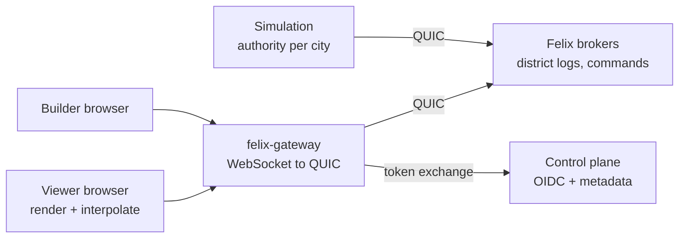

# Felix Metro design

A city simulator that runs in the browser in 3D, whose entire backend is
[Felix](https://github.com/GetFelix/felix). Low-poly buildings, roads, cars and
people go about a day that runs about 24 minutes. Everything that happens is
written to durable Felix streams, and the headline feature comes from that: drag
the timeline back and the city goes back with it. The sun runs backwards, cars
reverse along their routes, buildings come down. Let go and the city plays
forward from that moment and catches up to live with no gap.

[felix-arena](https://github.com/GetFelix/felix-arena) shows a log being the
live feed and the replay at once, over five-minute matches. Felix Metro shows
the same thing over a long history, where seeking matters more than following:
"show me 08:15 three days ago" has to be quick, and the log has to stay small
enough to keep days of it.

**In scope**

- One procedurally generated city per name, from a seed: a road grid, zoned districts, buildings, residents and their cars
- Residents with daily schedules (home, commute, work, errands, home) driving and walking on the road graph
- Live view in 3D with a tilted, orbitable camera, a day/night cycle and a tilt-shift miniature look
- A timeline to scrub back to any moment the log still holds, with markers for notable events
- Following one resident or car through their day
- Building: placing and removing roads, zones and buildings as commands the simulation applies
- Branching: forking the city at a past moment into a new timeline and comparing the two

**Out of scope**

- Economy depth (budgets, taxes, land value). The city has a few headline numbers, not a finance model
- Utilities, disasters, public transport networks beyond what a milestone names
- Accurate traffic modelling. Congestion is simple and plausible, not a research model
- Anything that needs a second datastore. If a feature cannot be expressed in streams, stream state, caches and counters, it is out

## What it has to demonstrate

1. **Rewind to any moment, quickly.** From any position on the timeline, the city is drawn at that moment in under a second.
2. **Rewind, then follow live with no gap.** Playing forward from the past joins live delivery without a missing or repeated event.
3. **A small log.** A city of 20,000 residents writes on the order of 10 KB/s, so a week of history is a few gigabytes on one broker.
4. **One authority that survives a restart.** The simulation is fenced at the broker, and a replacement picks up from the log where the last one stopped.
5. **Forks are cheap.** A branch starts from a keyframe of the parent and owes it nothing after that.

## Architecture

| Component | Language | Holds state? | Responsibility |
|---|---|---|---|
| Client | TypeScript, Three.js, `core` as WebAssembly | A view of the city at one moment | Render, interpolate motion along routes, seek, timeline |
| Gateway | [felix-gateway](https://github.com/GetFelix/felix-gateway) | No | Browser transport, token narrowing to one city, sender stamp on commands |
| Simulation | Rust, `core` + `felix-client` | Yes, recoverable from the log | Step every district of a city in lockstep, commit each tick |
| Brokers | Felix | Yes, authoritative | District logs, keyframe pointers, command stream |
| Control plane | Felix | Yes, metadata | Token exchange, city registration, RBAC |

### Shared rules in `core`

City generation from a seed, the road graph, schedules, routing, the record
encoding and route interpolation live in one Rust crate with no I/O. The sim
links it natively and the browser loads it as WebAssembly. The browser does not
simulate; it uses `core` to decode records, rebuild the road graph from the
seed and keyframes, and move a car along its route between events. Integer
arithmetic throughout, as in felix-arena, so the two builds agree exactly.

### City layout

`City::generate(seed, districts_per_side)` builds the same city on every platform from integer arithmetic and a seeded generator. A district is 12 by 12 tiles with a road on every fourth tile, which leaves 3 by 3 blocks of 3 by 3 lots. Roads also close the far edge, so the city is `12 * d + 1` tiles across. Roads on district boundaries are avenues and the rest are streets; every segment joins two neighbouring intersections, including across district edges. One block in each district is a park. The Felix tower stands on the dry lot nearest the city centre, downtown blocks surround it, and commercial, suburban and industrial blocks follow outwards. A lot faces the road beside it; the middle lot of a block has none beside it and gets a random facing. Some seeds, `harbor` among them, put water along one edge: the outermost row of blocks has no lots. Each lot's building kind is an index into a table in `core` that names a Kenney pack and model. Street, business and resident names come from built-in lists. `City::hash` is an FNV-1a hash of the whole layout, so the sim and the browser can check they generated the same city.

### Districts are shards

A city is a grid of districts, and each district is one shard of the city's
event stream. The sim routes every commit with the district as its entity key.
This keeps each district's history in order on its own shard and spreads a big
city over brokers.

One sim task steps all districts of a city in lockstep. Each tick it commits one
record per district, in parallel, and waits for all of them before the next
tick. Because one process owns every district, a resident crossing a district
boundary is a `left` event in one tick record and an `entered` event in the
other, in the same tick. Splitting one city across several sim processes is
not needed at the target scale and is left out.

## Time

- **Each tick is 15 seconds of city time**, so a city day is 5,760 ticks. At normal speed the sim steps at 4 Hz and a day takes 24 real minutes: short enough that a few minutes of watching shows rush hour and nightfall.
- **Speed changes the tick rate, not the tick.** Pause, 1×, 2× and 4× step at 0, 4, 8 and 16 Hz. A tick always covers the same city time, so the tick number stays a linear clock and seeking and interpolation never need to know the speed. The log costs the same per city day at any speed; only its rate per real second changes.
- **Speed belongs to the city, not the viewer.** It is set on the sim, written in every tick header, and changed with a `speed` event, so a seek can turn wall time into ticks across speed changes. A viewer's playback speed while scrubbing is separate and local.
- **The tick number is the city's clock.** Every record carries it. "The city at 08:15 on day 3" is a tick number, and the city at a tick is every district rewound to that tick.
- **Offsets are per district.** Districts are aligned by tick, never by offset.

## Records

### Events, not positions

A car's position every tick would cost around 4 MB/s for 10,000 cars. The sim
writes decisions instead, and the client works out positions:

| Event | Fields | Meaning |
|---|---|---|
| `trip` | resident, vehicle, depart tick, route (road segment ids), speed profile | Leaves now along this route |
| `replan` | resident, from segment, new route, tick | A jam or a closed road changed the route |
| `arrived` | resident, place, tick | Reached a building |
| `activity` | resident, kind (sleep, work, shop, ...), until tick | What they are doing inside |
| `left` / `entered` | resident, vehicle state | Crossed into another district |
| `built` / `demolished` | lot, building kind, rotation | A building changed |
| `road` | segment, change | A road was added, removed or closed |
| `command` | principal hash, command id, result | A builder's command was applied or refused |
| `speed` | ticks per second | The city's speed changed; 0 is paused |

A trip is about 60 bytes. A resident makes five or six trips a city day, so a
city of 20,000 residents writes about 5 KB/s of events at normal speed.

### Tick records

Each district commits one record per tick: a header (epoch, city, district,
tick number, speed, flags, the offset of the district's latest keyframe) followed by
that tick's events. A tick with no events is still committed, so every tick has
a record in every district. Seeking depends on that.

### Keyframes

Every 240 ticks (one real minute, one city hour) each district commits a
keyframe: its buildings, roads, and every resident in it with their current
activity or trip. A keyframe can be drawn with nothing before it. Its commit
also writes the stream state key `keyframe`, so the newest one is one
`state_get` away, with its offset as the value's version.

20,000 residents at about 16 bytes each is about 320 KB per city hour, about
5 KB/s. Events and keyframes together come to about 10 KB/s, or under 1 GB a day.

### Ticks are commits

Each tick record is a Felix `commit` on its district's shard, for the same
reasons felix-arena uses it: the answer carries the offset (the next tick
record needs the keyframe's offset), a keyframe and its state pointer land
together, and the sim waits for each answer, so records land in tick order.

The sim fences itself with `publish_if`/`commit`'s expected offset on each
district, so a stale sim that comes back after a replacement took over is
refused at the broker instead of writing a second history.

## Seeking

To draw tick `T`:

1. For each district, find a record at or before `T`. Every tick has one record, so the client estimates the offset from the district's current tick and offset, reads one record, and corrects; with `offset_for_time` in the gateway this becomes one lookup by the record's append time.
2. That record's header names the district's latest keyframe offset. Read the keyframe.
3. Read from the keyframe to `T` with a bounded `read` and apply the events.
4. Draw. Cars in the middle of a trip are placed by interpolating their route at `T`.

At most 240 tick records per district separate a keyframe from `T`. That is a
few hundred KB at the target scale, read in parallel across districts.

**Playing forward** from `T` is a subscribe from the next offset on each
district. Felix joins stored history to live delivery with no gap, so playing
forward catches up to live without the client doing anything special. Playback
faster than real time reads ahead with `read` and does not subscribe until it
is close to the tail.

**Scrubbing** draws the nearest keyframe while the handle moves and fills in
events once it stops.

## Building

Builders publish commands (`place road`, `zone`, `build`, `demolish`) to the
city's command stream, a gateway `stamp_sender` stream. The sim applies
commands at the next tick and records the result as a `command` event in the
district it touched, with a hash of the principal. Every change to the city
carries who made it, and that is visible on the timeline.

Building is only allowed at the live tip. A builder who scrubs back sees the
past read-only, and building there means forking.

## Branching

A fork is a new city whose name records its parent and fork tick
(`harbor~bridge-closed`). The sim seeds it by copying each district's keyframe
at or before the fork tick into the fork's stream, replays the parent's events
up to the tick, and steps on from there, so the fork owes the parent nothing
after creation. The parent and fork can be shown side by side with their
timelines locked to the same tick.

## Rendering

- **Three.js**, plain TypeScript, no UI framework, built with Vite.
- **Kenney city kits** (Roads, Commercial, Suburban, Industrial, Car Kit): CC0, one consistent style, restyled by material name to one palette.
- **Instanced meshes** for cars, people, trees and repeated buildings.
- **Tilt-shift**: a depth-of-field pass weighted to the top and bottom of the frame, with saturated colour, so the city reads as a model.
- **Day and night from the tick.** Sun angle, sky, street lights and window lights all follow the city clock, live and while scrubbing.
- **Quality tiers** so the look degrades before the frame rate does. The target is 60 fps at 20,000 residents on a laptop iGPU.

How it looks gets its own note, `docs/art.md`, and a style frame, in M0.

## Build order

| M | Milestone | Proves |
|---|---|---|
| 0 | The look, locked: style frame, asset pipeline, tilt-shift, day/night, instancing, quality tiers | It looks good at 60 fps before anything is simulated |
| 1 | A live city: `core`, the sim committing district ticks, the dev stack, the browser drawing live | Trips flow through Felix and look right |
| 2 | Time travel: keyframes, seeking, the timeline, rewind then follow | Demonstrations 1 and 2, the headline |
| 3 | Follow a life: pick a resident or car, see their day; markers for notable events | Per-entity history from the same log |
| 4 | Build: commands, placement tools, attribution | One authority applies everyone's edits |
| 5 | Branching timelines: fork, side by side | Demonstration 5 |
| 6 | Scale and failover: 20,000 residents, 16 districts, sim restart, broker loss | Demonstrations 3 and 4 |
| 7 | Self-hosting: images, compose, Helm, releases | Anyone can run it |

**M0 comes first on purpose**, for the reason felix-arena gives: looking very
good is the requirement most likely to fail late, so the look is fixed before
anything is built inside it.

## Risks, and what this surfaces in Felix

- **Interpolation drift.** A car drawn by interpolation can disagree with where the sim thinks it is if the sim changes its plan without a `replan`. Every change of plan is an event, and the client trusts the log over its own guess.
- **Retention.** History is bounded by one broker's disk. At 1 GB a day that is weeks, but tiered storage that Felix can read back would make it unbounded.
- **Scope.** No feature that does not serve one of the five demonstrations or the look.

**Felix gaps this design runs into**

1. **No time lookup in the gateway.** `offset_for_time` exists in Felix but felix-gateway does not expose it, so seeking estimates and corrects. Adding it upstream makes a seek one lookup per district.
2. **Per-shard subscribe through the gateway.** The gateway's `read` takes a shard. Subscribing to one district's shard from a browser needs checking, and adding if missing.
3. **Tiered storage has no read path.** Offloaded segments cannot be read back, so history older than local retention is gone.
4. **A commit is not idempotent.** A retried tick can land twice; readers dedupe on `(epoch, district, tick)`.

**Open questions**

- [ ] One keyframe per city hour, or adaptive (more often when a lot changed)?
- [ ] Should forks be visible to everyone, or private to the person who made them?
