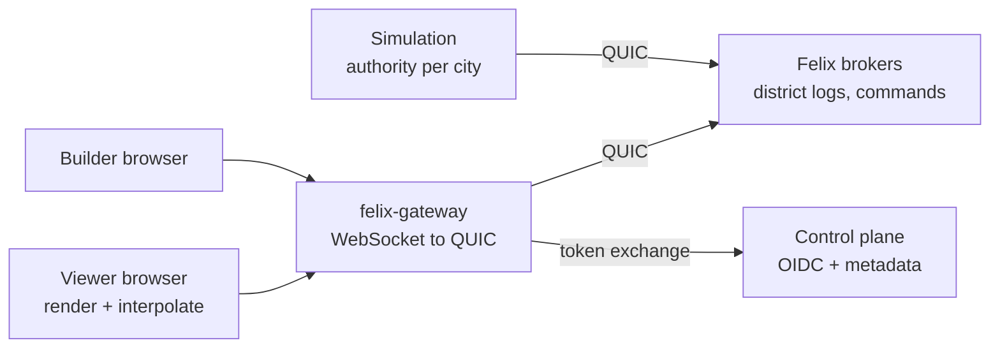

# Felix Metro design

A city simulator that runs in the browser in 3D, whose entire backend is
[Felix](https://github.com/GetFelix/felix). Low-poly buildings, roads, cars and
people go about a day that runs about 24 minutes. Everything that happens is
written to durable Felix streams, and the headline feature comes from that: drag
the timeline back and the city goes back with it. The sun runs backwards, cars
reverse along their routes, buildings come down. Let go and the city plays
forward from that moment and catches up to live with no gap.

[felix-arena](https://github.com/GetFelix/felix-arena) shows a log being the
live feed and the replay at once, over five-minute matches. Felix Metro shows
the same thing over a long history, where seeking matters more than following:
"show me 08:15 three days ago" has to be quick, and the log has to stay small
enough to keep days of it.

**In scope**

- One procedurally generated city per name, from a seed: a road grid, zoned districts, buildings, residents and their cars
- Residents with daily schedules (home, commute, work, errands, home) driving and walking on the road graph
- Live view in 3D with a tilted, orbitable camera, a day/night cycle and a tilt-shift miniature look
- A timeline to scrub back to any moment the log still holds, with markers for notable events
- Following one resident or car through their day
- Building: placing and removing roads, zones and buildings as commands the simulation applies
- Branching: forking the city at a past moment into a new timeline and comparing the two

**Out of scope**

- Economy depth (budgets, taxes, land value). The city has a few headline numbers, not a finance model
- Utilities, disasters, public transport networks beyond what a milestone names
- Accurate traffic modelling. Congestion is simple and plausible, not a research model
- Anything that needs a second datastore. If a feature cannot be expressed in streams, stream state, caches and counters, it is out

## What it has to demonstrate

1. **Rewind to any moment, quickly.** From any position on the timeline, the city is drawn at that moment in under a second.
2. **Rewind, then follow live with no gap.** Playing forward from the past joins live delivery without a missing or repeated event.
3. **A small log.** A city of 20,000 residents writes on the order of 10 KB/s, so a week of history is a few gigabytes on one broker.
4. **One authority that survives a restart.** The simulation is fenced at the broker, and a replacement picks up from the log where the last one stopped.
5. **Forks are cheap.** A branch starts from a keyframe of the parent and owes it nothing after that.

## Architecture

| Component | Language | Holds state? | Responsibility |
|---|---|---|---|
| Client | TypeScript, Three.js, `core` as WebAssembly | A view of the city at one moment | Render, interpolate motion along routes, seek, timeline |
| Gateway | [felix-gateway](https://github.com/GetFelix/felix-gateway) | No | Browser transport, token narrowing to one city, sender stamp on commands |
| Simulation | Rust, `core` + `felix-client` | Yes, recoverable from the log | Step every district of a city in lockstep, commit each tick |
| Brokers | Felix | Yes, authoritative | District logs, keyframe pointers, command stream |
| Control plane | Felix | Yes, metadata | Token exchange, city registration, RBAC |

### Shared rules in `core`

City generation from a seed, the road graph, schedules, routing, the record
encoding and route interpolation live in one Rust crate with no I/O. The sim
links it natively and the browser loads it as WebAssembly. The browser does not
simulate; it uses `core` to decode records, rebuild the road graph from the
seed and keyframes, and move a car along its route between events. Integer
arithmetic throughout, as in felix-arena, so the two builds agree exactly.

### City layout

`City::generate(seed, districts_per_side)` builds the same city on every platform from integer arithmetic. Every random choice is a stateless hash of the seed, a stage and the place it is made, so a small change stays local and nothing depends on the order things are drawn. The city is `12 * d + 1` tiles across, the road along each far edge included. Districts are 12 by 12 tiles and only shard the city; roads and blocks ignore them.

- **Arterials** cross the whole city at hashed spacing of 7 to 12 tiles. Segments on them are avenues (faster); every other road is a street.
- **Blocks** come from splitting the space between arterials with streets, each split keyed on the rectangle it cuts. The block size depends on the zone: small downtown, longer in the suburbs, industrial superblocks with a yard inside. A few splits are skipped, a few suburban streets stop short as dead ends, and a union-find pass keeps one connected road graph.
- **Land value** (0 to 255) falls off with distance from the main centre and from one or two secondary centres at arterial crossings, rises along arterials and by the water, and carries low-frequency noise. Downtown sits at the peaks, commercial where value is middling or along an arterial, suburbs elsewhere, and industry in a hashed band along an edge or the waterfront. One block in each district is a park. Buildings are taller where value is higher, with jitter; corner lots get the bigger and taller models.
- **Lots** are the non-road tiles. A lot beside a road faces it (shops prefer the arterial) and has a door, a segment and an offset along it, for residents to route to. A tile with no road beside it is filler (trees or a plaza prop) with no door and no home or business. The Felix tower stands on the downtown lot nearest the main centre.
- **Road pieces:** each road tile reports its piece (straight, corner, T, cross or end), its neighbour mask and a rotation, for the browser to draw.
- **Water** is a mask over the finished layout. Some seeds, `harbor` among them, have a ragged shoreline 3 to 6 tiles deep along one edge. The edge is reserved whether or not the seed is wet, and centres, the tower and parks keep clear of it, so the layout never depends on the water. Tiles under water lose their road and lot; a lot whose road went under is flooded with it, and so is any road the water cut off from the rest. Everything else is identical to the dry city.

Seeds are parts of 1 to 32 characters of `a-z`, `0-9` and `-`, joined by `~` for forks. Each lot's building kind is an index into a table in `core` that names a Kenney pack and model. Street, business and resident names come from built-in lists. `City::hash` is an FNV-1a hash of the whole layout, so the sim and the browser can check they generated the same city. `cargo run -p felix-metro-core --example map -- harbor 2` prints a city as ASCII.

### Residents, schedules and routes

`core` also draws the people. A city has two residents for each suburban lot with a door, and resident `i` is fixed by the seed and `i`: an archetype (office worker, shift worker, shopkeeper, student, retiree or night worker), a home, and a workplace that is the nearest of three random picks from the places that suit the archetype. Times are jittered per resident, and people leave early enough by a rough travel estimate to arrive at their usual time.

A day is a cycle of blocks, each a lot and the tick of the day they leave it. The last block's trip returns to the first, so the day closes. A night worker's day starts at work, because they are still there at midnight. A trip leaves at its scheduled tick, or on arrival if the last one ran late.

A route is an A* search over the road graph. Costs are integer milliseconds of travel, a door sits partway along its segment so the search starts and ends from both ends of it, and the heuristic is the fewest tiles between nodes at the fastest road speed. The sim passes in last tick's vehicle count for each segment. A segment holds three cars a tile before it slows, then runs at that share of its speed down to a fifth, and the trip drives it at that speed, so the route chosen is the route taken. A route of 4 tiles or less is walked at 0.3 tiles a second.

A trip is its legs, each with a speed percentage, and a depart tick; every leg's end tick follows from them. `position_at(tick)` interpolates in integers, so it never moves backwards along the route and gives the same answer natively and in WebAssembly.

### Districts are shards

A city is a grid of districts, and each district is one shard of the city's
event stream. The sim routes every commit with the district as its entity key.
This keeps each district's history in order on its own shard and spreads a big
city over brokers.

Felix maps an entity key to a shard by hashing it, and the keys `d00` to `d03`
do not land on four different shards of a four-shard stream. So district `i`
commits with `d<NN>` where that hashes to shard `i`, and with `d<NN>.<n>` for
the first `n` that does where it does not. The stream needs a shard for every
district, and district `i` is always shard `i`.

One sim task steps all districts of a city in lockstep. Each tick it commits one
record per district, in parallel, and waits for all of them before the next
tick. Because one process owns every district, a resident crossing a district
boundary is a `left` event in one tick record and an `entered` event in the
other, in the same tick. Splitting one city across several sim processes is
not needed at the target scale and is left out.

## Time

- **Each tick is 15 seconds of city time**, so a city day is 5,760 ticks. At normal speed the sim steps at 4 Hz and a day takes 24 real minutes: short enough that a few minutes of watching shows rush hour and nightfall.
- **Speed changes the tick rate, not the tick.** Pause, 1×, 2× and 4× step at 0, 4, 8 and 16 Hz. A tick always covers the same city time, so the tick number stays a linear clock and seeking and interpolation never need to know the speed. The log costs the same per city day at any speed; only its rate per real second changes.
- **Speed belongs to the city, not the viewer.** It is set on the sim, written in every tick header, and changed with a `speed` event, so a seek can turn wall time into ticks across speed changes. A viewer's playback speed while scrubbing is separate and local.
- **A speed change takes effect between ticks.** The sim reads the requested speed after every district has answered a tick, so the next tick's header carries the new speed and each district's record for it holds a `speed` event; no other tick has one. Changing to 0 commits that tick as the last one (header speed 0), then the clock stops: no records are written while paused and the city clock does not move. A resume continues at the next tick, due at once and at the new rate from then on, with no catch-up burst. Only 0, 4, 8 and 16 are accepted. Seeking goes by tick number and offset, and nothing in `core` reads the speed.
- **Until builders get a control, the operator sets it** with `SIM_TICKS_PER_SECOND` at start and a loopback-only HTTP endpoint on the sim (`PUT /cities/<name>/speed`). The `speed` command from the command stream replaces the endpoint.
- **The tick number is the city's clock.** Every record carries it. "The city at 08:15 on day 3" is a tick number, and the city at a tick is every district rewound to that tick.
- **Offsets are per district.** Districts are aligned by tick, never by offset.

## Records

### Events, not positions

A car's position every tick would cost around 4 MB/s for 10,000 cars. The sim
writes decisions instead, and the client works out positions:

| Event | Fields | Meaning |
|---|---|---|
| `trip` | resident, vehicle kind, depart tick, route (segment ids with a speed each) | Leaves now along this route |
| `replan` | resident, from segment, new route | A jam or a closed road changed the route |
| `arrived` | resident, lot | Reached a building |
| `activity` | resident, kind (sleep, work, shop, ...), until tick | What they are doing inside |
| `left` / `entered` | resident, other district, vehicle state with the route left | Crossed into another district |
| `built` / `demolished` | lot, building kind, rotation | A building changed |
| `road` | segment, change (closed, opened, added, removed) | A road changed |
| `command` | principal hash, builder name, command id, result | A builder's command was applied or refused |
| `speed` | ticks per second | The city's speed changed; 0 is paused |

A route is its segment ids from the road graph (`u32`) and one speed byte per
segment, a percentage of the segment class's speed. A trip of 12 segments is 36
bytes, so a resident making five or six trips a city day, in a city of 20,000
residents, writes under 5 KB/s of events at normal speed.

### Byte layouts

Every record starts with a kind byte, and a layout change gets a new kind.
Integers are little-endian. A varint is LEB128 in its shortest form (a padded
one is refused, so a retried tick is the same bytes), and a delta is a zigzag
varint of the difference from the previous id in the list, so lists need no
order. A string is a length byte and UTF-8, at most 64 bytes; encoding refuses a
longer one instead of cutting it. `core/src/record.rs` encodes and decodes all
of them.

Decoding returns an error for truncated or trailing bytes, an unknown kind or
header flag bit, an out-of-range value, a string over 64 bytes or bad UTF-8,
and a body shorter than its tag's fields. Flag bits choose the layout, so
they stay strict, as in the wire protocol. Events and a keyframe's resident
entries are framed instead (a tag, a varint body length and the body), so an
older reader skips a tag it does not know and keeps the rest of the tick, and
ignores bytes appended to a body it does know. A field can therefore be added
to the end of an event without a new kind.

| Kind | Record |
|---|---|
| 1 | Tick record, a district's commit for one tick |
| 2 | Command, on `metro.commands.<city>` |
| 3 | Registry entry, on `metro.cities` |

### Tick records

Each district commits one record per tick. A tick with no events is still
committed, so every tick has a record in every district. Seeking depends on
that.

| Offset | Size | Field |
|---|---|---|
| 0 | 1 | kind, 1 |
| 1 | 4 | `epoch`, the sim's term; a new sim takes the last plus one |
| 5 | 2 | `district` |
| 7 | 4 | `tick` |
| 11 | 1 | `speed`, ticks per second |
| 12 | 1 | `flags`; bit 0 is a keyframe, other bits are refused |
| 13 | 8 | `keyframe_offset`, the district's latest keyframe (a keyframe names itself) |
| 21 | 8 | `wall_us`, microseconds since the Unix epoch at commit |
| 29 | 2 | `events`, the number of events |
| 31 | | the keyframe if bit 0 is set, then the events |

An event is a tag byte, a varint body length and the fields below. `resident`
is a `u32`. `events` counts every event, including ones a reader skips.

| Tag | Event | Fields |
|---|---|---|
| 1 | `trip` | resident, vehicle `u8`, depart `u32`, route |
| 2 | `replan` | resident, from segment `u32`, route |
| 3 | `arrived` | resident, lot `u32` |
| 4 | `activity` | resident, kind `u8`, until `u32` |
| 5 | `left` | resident, district `u16`, vehicle state |
| 6 | `entered` | resident, district `u16`, vehicle state |
| 7 | `built` | lot `u32`, kind `u16`, rotation `u8` |
| 8 | `demolished` | lot `u32`, kind `u16`, rotation `u8` |
| 9 | `road` | segment `u32`, change `u8` |
| 10 | `command` | principal `u64`, name, id `u32`, result `u8` |
| 11 | `speed` | ticks per second `u8` |

A route is a varint leg count, the segment ids (first as a delta from 0, then
each from the one before), then one speed byte per leg. A vehicle state is kind
`u8`, progress along its first leg in thousandths `u16` (0 to 1000), and a
route.

An activity `kind` is the schedule's activity: 0 home, 1 work, 2 school, 3 shop,
4 leisure. Sleep is not one; a viewer shows a resident at home through the night
as asleep. A vehicle `kind` of 0 is a walker. In a tick, a resident's `arrived`
and `activity` are in the district of the lot they reach, `trip` is in the
district of the lot they leave, and a resident who drives into another district
is `left` there and `entered` here, in the tick the vehicle first is in it.

### Keyframes

Every 240 ticks (one real minute, one city hour) each district commits a
keyframe: a tick record with flag bit 0 set, whose keyframe goes between the
header and the events. A keyframe can be drawn with nothing before it. Its
commit also writes the stream state key `keyframe`, so the newest one is one
`state_get` away, with its offset as the value's version.

| Part | Contents |
|---|---|
| buildings | varint count; per lot that differs from the generated city: lot delta, kind `u16` (65535 for none), rotation `u8` |
| roads | varint count; per segment closed or added: segment delta, change `u8` |
| residents | varint count; per resident in the district: id delta, then a framed state: tag `0`, kind `u8`, lot `u32` and until varint (an activity in that lot), or tag `1` and a vehicle state (a trip in progress) |
| counts | varints: home, at work, on the road, asleep. Home between 22:00 and 06:00 is asleep; work and school are at work; shopping and leisure are in none of them |

Because buildings and roads are diffs against the city the seed generates, the
keyframe of a city nobody has built in carries none of them, and the cost is
the residents.

20,000 residents at about 16 bytes each is about 320 KB per city hour, about
5 KB/s. Events and keyframes together come to about 10 KB/s, or under 1 GB a day.
The counts are what the stats sparkline plots.

### Commands and the registry

A command record is the kind byte, a command id `u32`, the builder's display
name, a tag and fields. It carries no principal: the gateway's `stamp_sender`
adds who sent it outside the payload, and the sim copies that principal hash
with the name into the `command` event of the district it touched.

The display name comes from the ID token's name claim, chosen client-side, so it
is whatever the builder chose and is shown as given. The record layer only
limits it to 64 bytes. A fork's name is a seed part, 1 to 32 characters of
`a-z`, `0-9` and `-`, and the sim refuses the command (result code) when it is
not. The lineage name `harbor~bridge-closed` that registry records carry must
fit 64 bytes too, so a fork too deep to name is refused the same way.

| Tag | Command | Fields |
|---|---|---|
| 1 | place road | node a `u32`, node b `u32` |
| 2 | zone | lot `u32`, zone `u8` |
| 3 | build | lot `u32`, kind `u16`, rotation `u8` |
| 4 | demolish | lot `u32` |
| 5 | speed | ticks per second `u8` |
| 6 | fork | tick `u32`, name |

A registry record is the kind byte, a tag and fields: `1` created (name, seed,
districts `u16`, `wall_us` `u64`) or `2` forked (name, parent, tick `u32`,
`wall_us` `u64`).

### Ticks are commits

Each tick record is a Felix `commit` on its district's shard, for the same
reasons felix-arena uses it: the answer carries the offset (the next tick
record needs the keyframe's offset), a keyframe and its state pointer land
together, and the sim waits for each answer, so records land in tick order.

Every commit is a `commit_if` at the offset the sim expects the district's shard
to be at, so the sim always knows the offset a record will have. A keyframe
puts that offset in its own `keyframe_offset` and in the `keyframe` state key
in the same commit. A stale sim that comes back after a replacement took over is
refused at the broker instead of writing a second history, and a sim that
starts over a city that already has history stops.

A district that gets no answer is sent the same bytes again at the same
expected offset, after a growing wait. If the shard's tail shows the earlier
send landed, that is the answer. The sim does not move on until every district
has answered, and a slow tick runs late: the next one starts a period after it
ends, so no tick is skipped and none is made up in a burst.

## The live view

The page follows a city through the gateway on one connection, one subscription
per district shard in a slot of its own (`d00`, `d01`, ...). To start it does
what [Seeking](#seeking) does for the newest moment, in an order that cannot
lose a record:

1. Subscribe to every district from live and hold what arrives. Each answer
   says the shard's tail.
2. Read each district's `keyframe` state key. The key is held under the
   district's entity key, which depends on how the stream hashes keys, and
   Felix does not report that to a browser, so the page tries both routings
   and trusts a pointer only when the record it names is that district's
   keyframe.
3. Read the keyframe and everything up to the tail, apply it, then the held
   records. A record at or before a district's newest tick is skipped, so a
   reconnect can read from the keyframe again.

The page draws one tick behind the newest one every district has, so a car
always has both ends of its motion. Its clock runs at the sim's speed and is
steered to keep that one tick of lag: a late record slows it, a burst speeds it
up, it never passes the newest tick and never runs backwards. The hour of day
is the tick's, never the wall clock's, so the sun, lamps and windows follow the
sim. A `trip` event gives a resident's route; the page rebuilds the trip from
its legs and the resident's schedule (`Resident::trip_from_route`), which
finds which of the resident's days it belongs to and where the first and last
leg start and end, and places the car by `position_at`. A trip that matches no
route is counted, not drawn. Trips already under way when a page opens are
not drawn until their resident's next trip.

## Seeking

To draw tick `T`:

1. For each district, find a record at or before `T`. Every tick has one record, so the client estimates the offset from the district's current tick and offset, reads one record, and corrects; with `offset_for_time` in the gateway this becomes one lookup by the record's append time.
2. That record's header names the district's latest keyframe offset. Read the keyframe.
3. Read from the keyframe to `T` with a bounded `read` and apply the events.
4. Draw. Cars in the middle of a trip are placed by interpolating their route at `T`.

In the browser, `web/src/seek.ts` does this on a connection of its own, so a seek never waits behind the live
subscriptions. One `Seeker` lives for the page: its session and caches carry from seek to seek, a newer seek cancels
an older one (its queued reads leave the gateway's queue), identical reads in flight are shared, and the districts are
read concurrently over two connections taken in turn (opened by the first seek, closed after 30 s idle and opened again by the next, so a page that is not seeking holds none of the gateway's eight sessions a person may have), the pages of a range together once the first has said how big a page is. A seek returns each district's records from its keyframe and the offset of the tick's record, which
is where a live subscription resumes, plus one.

The log is ordered by `(epoch, tick)`. A restarted sim takes the next epoch, so the newest epoch that reaches a tick is the
one shown, and a tick that landed twice is applied once. The estimate starts from the cached keyframe of `T`'s hour, or
else the newest keyframe the state key points at, and a log that is not one record a tick falls back to bisection between the
offsets known to be below and above `T`. A tick the log skipped shows the nearest earlier tick every district has, and the
result says it is not exact; a tick past the newest is refused as not yet happened. Retention that has taken the named
keyframe moves the start to the next hour boundary still kept, and a seek is `unretained` before it. Records are cached per
district for about two city hours and keyframes for four city days, so a second seek in the same hour reads only the
ticks past what is held. After folding, every district must be at `T`, or the seek fails. `?at=<tick>` opens the page at a
tick with no live connection (the timeline's "Back to live" opens the page again without it), and `window.__metro.seek(tick)` does the same in an open page,
which is what CI measures against the one-second budget.

At most 240 tick records per district separate a keyframe from `T`. That is a
few hundred KB at the target scale, read in parallel across districts.

**Playing forward** from `T` is a subscribe from the next offset on each
district. Felix joins stored history to live delivery with no gap, so playing
forward catches up to live without the client doing anything special. Playback
faster than real time reads ahead with `read` and does not subscribe until it
is close to the tail.

**Scrubbing** draws the nearest keyframe on hand while the handle moves, with
the sun and the clock at the handle's hour, and fills in events once it rests.
One seek runs at a time, always for the newest target, and each result is drawn
as it completes, so scrubbing faster than a seek takes still shows the city
moving; a seek is never cancelled by the next move. A target ahead of the city
on screen in the same hour folds only the records after the last one it holds;
any move back refolds from the keyframe. The newest record of each district is
trusted for a second between seeks. The bar spans the first hour that can be
started from to the live tip, with days as bands and a tick for every hour.
Arrow keys step 15 city minutes, `Shift` or the page keys an hour, `Home` goes to
the oldest moment and `End` back to live. The pill in the clock reads how long
before the live tip the city on screen is, in city time.

## Building

Builders publish commands (`place road`, `zone`, `build`, `demolish`) to the
city's command stream, a gateway `stamp_sender` stream. The sim applies
commands at the next tick and records the result as a `command` event in the
district it touched, with a hash of the principal. Every change to the city
carries who made it, and that is visible on the timeline.

Building is only allowed at the live tip. A builder who scrubs back sees the
past read-only, and building there means forking.

## Branching

A fork is a new city whose name records its parent and fork tick
(`harbor~bridge-closed`). The sim seeds it by copying each district's keyframe
at or before the fork tick into the fork's stream, replays the parent's events
up to the tick, and steps on from there, so the fork owes the parent nothing
after creation. The parent and fork can be shown side by side with their
timelines locked to the same tick.

## Rendering

- **Three.js**, plain TypeScript, no UI framework, built with Vite.
- **Kenney city kits** (Roads, Commercial, Suburban, Industrial, Car Kit): CC0, one consistent style, restyled by material name to one palette.
- **Instanced meshes** for cars, people, trees and repeated buildings.
- **Tilt-shift**: a depth-of-field pass weighted to the top and bottom of the frame, with saturated colour, so the city reads as a model.
- **Day and night from the tick.** Sun angle, sky, street lights and window lights all follow the city clock, live and while scrubbing.
- **Quality tiers** so the look degrades before the frame rate does. The target is 60 fps at 20,000 residents on a laptop iGPU.

How it looks gets its own note, `docs/art.md`, and a style frame, in M0.

## Build order

| M | Milestone | Proves |
|---|---|---|
| 0 | The look, locked: style frame, asset pipeline, tilt-shift, day/night, instancing, quality tiers | It looks good at 60 fps before anything is simulated |
| 1 | A live city: `core`, the sim committing district ticks, the dev stack, the browser drawing live | Trips flow through Felix and look right |
| 2 | Time travel: keyframes, seeking, the timeline, rewind then follow | Demonstrations 1 and 2, the headline |
| 3 | Follow a life: pick a resident or car, see their day; markers for notable events | Per-entity history from the same log |
| 4 | Build: commands, placement tools, attribution | One authority applies everyone's edits |
| 5 | Branching timelines: fork, side by side | Demonstration 5 |
| 6 | Scale and failover: 20,000 residents, 16 districts, sim restart, broker loss | Demonstrations 3 and 4 |
| 7 | Self-hosting: images, compose, Helm, releases | Anyone can run it |

**M0 comes first on purpose**, for the reason felix-arena gives: looking very
good is the requirement most likely to fail late, so the look is fixed before
anything is built inside it.

## Risks, and what this surfaces in Felix

- **Interpolation drift.** A car drawn by interpolation can disagree with where the sim thinks it is if the sim changes its plan without a `replan`. Every change of plan is an event, and the client trusts the log over its own guess.
- **Retention.** History is bounded by one broker's disk. At 1 GB a day that is weeks, but tiered storage that Felix can read back would make it unbounded.
- **Scope.** No feature that does not serve one of the five demonstrations or the look.

**Felix gaps this design runs into**

1. **No time lookup in the gateway.** `offset_for_time` exists in Felix but felix-gateway does not expose it, so seeking estimates and corrects. Adding it upstream makes a seek one lookup per district.
2. **Per-shard subscribe through the gateway.** The gateway's `read` takes a shard. Subscribing to one district's shard from a browser needs checking, and adding if missing.
3. **Tiered storage has no read path.** Offloaded segments cannot be read back, so history older than local retention is gone.
4. **A commit is not idempotent.** A retried tick can land twice; readers dedupe on `(epoch, district, tick)`.

**Open questions**

- [ ] One keyframe per city hour, or adaptive (more often when a lot changed)?
- [ ] Should forks be visible to everyone, or private to the person who made them?
