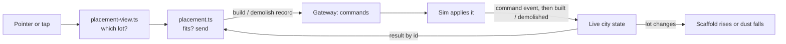
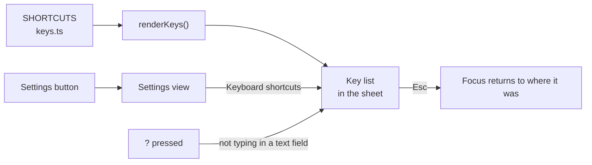
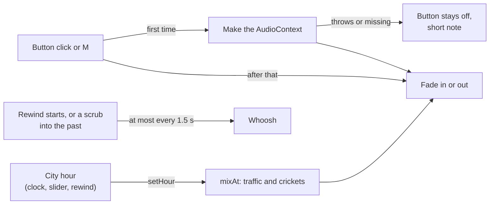
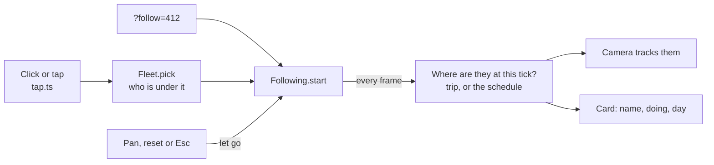
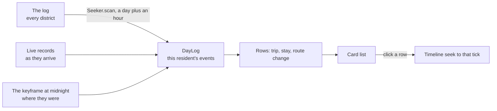

# The page overlay

The overlay is everything on the page that is not the city: the Felix Metro chip, the clock, the timeline,
the settings, sound, build and demolish buttons and the panels they open. This page says what it does, where it lives
in the code, and how to add to it. It also holds the rules (colour, type, motion and wording) that keep new
controls looking like the ones already there.

| Day, with the LIVE pill                                       | Night, with the settings sheet                                         |
| ------------------------------------------------------------- | ---------------------------------------------------------------------- |
|       |   |
| **The key list**                                              | **A phone, looking at an earlier moment**                              |
|               |  |
| **Following a resident**                                      | **The follow card on a phone**                                         |
|  |      |

## What you can do

- **Choose a quality.** The button under the clock opens the settings sheet. Pick Automatic, High, Medium or Low.
  Automatic starts on High and eases off if the city stutters. A tier you pick is kept for next time, and
  choosing Automatic forgets it. [Quality tiers](art.md#quality-tiers) says what each tier changes.
- **See every key.** Press `?`, or open **Keyboard shortcuts** in the settings sheet. Press `Esc` to close
  the sheet. Focus goes back to where it was.
- **Turn the sound on.** The speaker button next to the settings button, or `M`, switches the ambient sound. It is off
  until you do. See [Sound](#sound).
- **Get a hint on a first visit.** When the timeline first appears, a line above it says "Drag the timeline to go
  back in time". It goes away on your first click, key press or scroll, or after a few seconds, and it is not
  shown again in that browser.
- **See who built a building.** Point at one and a card says who built it and when: "Built by Ana · Day 2, 09:12 ·
  See it go up". Your own read "Built by you", and buildings the city began with read "Here since the start". On a
  phone, tap the building; tap anywhere else to close the card. "See it go up" takes the city back to just before
  the building was built and plays it forward. It does the same as dragging the timeline there and pressing Play, so a
  page opened at a past moment (`?at`) goes there and stays paused. The card is a pointer feature: it is not
  reachable from the keyboard.
- **Follow a resident.** Click a car or walker (tap on a touch screen), or press `F` for the one nearest the middle of
  the view. The camera tracks them, and a card under
  the city name shows their name, what kind of resident they are, what they are doing now and their day: the trips and
  stays the log holds for them, a day at a time, with arrows for the day before and after. A row takes you to that
  moment. `Esc`, the card's close button or moving the view lets go (`Esc` first closes an open menu, the sheet or
  photo mode); turning and zooming do not. [Following a resident](../README.md#following-a-resident) says more.
- **Share a moment.** The link button under the settings button copies a link that opens the city at the moment on
  screen, from the same camera view, and with the same resident followed if there is one.
  [Moments](../README.md#moments) shows the link and how it is read.
- **Build and take down.** The two buttons at the left of the row under the clock, or `B` and `X`, pick the build and
  demolish tools. A panel under them picks the building, `R` turns it and the pointer moves a ghost of it from lot to
  lot. Click, or tap, to place it. On a touch screen a demolish takes two taps, one to pick the building and one to confirm,
  and the pick is dropped after a few seconds with no second tap. `H` (photo mode) puts the tools out of reach too: nothing is drawn
  or placed while the controls are hidden. The buttons are off, with a note that says why, when the page has no live city, is
  showing an earlier moment, or is signed in as someone who may only watch. [Building](../README.md#building) says
  what a builder may do and why only the cleared ground.
- **See the city in numbers.** `C`, or **City stats** in the settings sheet, shows a panel on the left edge with the
  residents, how many are on the road (in cars and on foot) and the buildings by kind. The numbers are for the moment
  on screen, so they change as you scrub, rewind or seek. The choice is remembered. `H` hides the panel with the other
  controls.
- **Hide the controls.** `H` hides every control, message, the follow card and the frame times, for a clean picture.
  `H` or `Esc` brings them back, and that `Esc` does not stop a follow. It does nothing while a field has focus or the
  settings sheet is open.
- **Leave it on a wall.** After a minute with no mouse, touch or key the camera turns slowly. Any input stops it.
- **Reach everything with the keyboard.** Every control can be focused with `Tab` and used with `Enter`,
  `Space` or the arrow keys. The focused control gets a cyan ring. With an earlier moment on screen, `Space` plays
  or pauses it, unless a button or field has focus, in which case it does that control's own job. `J`, `K` and `L`
  rewind, stop and speed up the playback, as in a video editor.

These page parameters change the overlay:

| Parameter        | Effect                                                                                                                                                                                                                 |
| ---------------- | ---------------------------------------------------------------------------------------------------------------------------------------------------------------------------------------------------------------------- |
| `?tier=low`      | Forces a quality for this visit (`low`, `medium` or `high`). It overrides the saved choice                                                                                                                             |
| `?ui=0`          | Hides the overlay: no chips, no buttons, no `?` or `M` key, no hint and no building card                                                                                                                               |
| `?capture&trace` | The same as `?ui=0` for the controls and the hint, since a clip must draw as is                                                                                                                                        |
| `?attract=30`    | Seconds with no input before the camera turns on its own (60 by default, `0` for never)                                                                                                                                |
| `?follow=412`    | Opens with the camera on resident 412 and their card. A resident the city lacks is said so                                                                                                                             |
| `?live=0`        | Draws the city with no gateway; the timeline never appears, so there is no hint, and the build buttons are off                                                                                                         |
| `?as=mayor`      | Picks which login the dev stack's stand-in identity provider signs in (`viewer` if left out); `mayor` may build. It grants nothing with a real provider, and a tab already signed in keeps its token, so use a new tab |
| `?hud`           | Shows frame times under the Felix Metro chip, for tuning                                                                                                                                                               |

## How it is built

The overlay is plain markup in `web/index.html`, styled by CSS files and wired up by TypeScript. There is no UI
framework. Each part has one file of each kind:

| Part                             | Code                                                               | Styles                       |
| -------------------------------- | ------------------------------------------------------------------ | ---------------------------- |
| Colours, spacing, glass, focus   |                                                                    | `web/src/ui/kit.css`         |
| Felix Metro chip and city picker | `web/src/ui/picker.ts`                                             | `web/src/ui/brand.css`       |
| Loading screen                   | `web/src/ui/loader.ts`                                             | `web/src/ui/loader.css`      |
| Clock, LIVE pill, past row       | `web/src/ui/clock.ts`, `web/src/ui/status.ts`                      | `web/src/ui/clock.css`       |
| Timeline bar                     | `web/src/timeline.ts`                                              | `web/src/ui/timeline.css`    |
| Settings sheet and key list      | `web/src/ui/shell.ts`, `settings.ts`, `keys.ts`, `sheet.ts`        | `web/src/ui/sheet.css`       |
| Share button, photo mode         | `web/src/ui/share.ts`, `web/src/ui/photo.ts`, `web/src/moments.ts` | `web/src/ui/photo.css`       |
| City stats panel                 | `web/src/ui/stats.ts`, `web/src/stats.ts`                          | `web/src/ui/stats.css`       |
| Follow card                      | `web/src/ui/follow-card.ts`, `web/src/follow.ts`, `web/src/tap.ts` | `web/src/ui/follow.css`      |
| A resident's day on the card     | `web/src/day.ts`, `web/src/day-panel.ts`                           | `web/src/ui/follow.css`      |
| Sound button                     | `web/src/ui/sound.ts`                                              | `web/src/ui/kit.css`         |
| Building card                    | `web/src/ui/attribution.ts`, `web/src/ui/lot-hover.ts`             | `web/src/ui/attribution.css` |
| Build and demolish tools         | `web/src/ui/build-bar.ts`, `web/src/placement.ts`                  | `web/src/ui/build.css`       |
| Hint and messages                | `web/src/ui/hint.ts`, `web/src/ui/toast.ts`                        | `web/src/ui/toast.css`       |
| Frame times (`?hud`)             | `web/src/ui/hud.ts`                                                | `web/src/ui/kit.css`         |

`index.html` links the CSS files in that order, so a later file can override an earlier one. Linking them from
the page, rather than importing them from TypeScript, means the overlay is styled before any script runs.

`web/src/main.ts` creates the controls that need the running page. It calls `createShell(quality)`, which builds the
settings button and sheet, and it asks the shell to show the hint once the timeline is on screen.

### The settings sheet

The sheet is one panel with two views, Settings and Keyboard shortcuts. `sheet.ts` does what any dialog needs:
it keeps `Tab` inside the panel, closes on `Esc` or a click outside, and gives focus back to the control that
opened it. The quality options are plain radio buttons, so the arrow keys move between them with no extra code.

Choosing an option goes through the quality controller in `web/src/quality.ts`:

- A tier calls `setTier(tier)`. The tier is saved in local storage and the automatic choice stops.
- Automatic calls `setAutomatic()`. The saved tier is forgotten and the controller judges frame times again
  from High, as on a first visit.

### The building tools

Three files with one job each, so the rules can be tested without a screen:

- `web/src/placement.ts` is the state of the tools: which one is held, the building and its turn, what the tool would do
  on a lot, and what became of every command sent. It knows nothing of the page; the page hands it the live city's
  buildings, the connection and a question, "is the live city what is on screen?".
- `web/src/ui/build-bar.ts` is the markup: the two buttons, the panel, and the keys, which are read from `BUILD_KEYS` in
  `web/src/build-keys.ts` the way the camera's are.
- `web/src/placement-view.ts` finds the lot under the pointer and draws the marker and the ghost. The ground point under
  the pointer is the wrong lot for a tall building, so it also follows the ray down from rooftop height and tests the
  lots it passes over against their models.

The rules (`web/src/build.ts`) mirror the sim's, and `placement.ts` checks them before it sends anything. The
buttons are off with a reason from `whyNot()`, and the tool in hand is put away if the page leaves the live city. A command
goes out as a record on the command stream; the answer is the `command` event the live state hands to
`placement.result()`, which matches it by the random id the page gave the command.



### The key list

The list is data. Every row is an entry in `SHORTCUTS` in `web/src/ui/keys.ts`, and the sheet draws its table
from that array. Nothing else knows about the rows, so a feature that adds a key adds one entry:

```ts
{ keys: [['Shift', '←'], ['Page Down']], action: 'Go back an hour' }
```

The camera's keys are the exception: the View and Mouse and touch groups are built from `CAMERA_KEYS` and
`CAMERA_GESTURES` in `web/src/camera-keys.ts`, so the list always matches what the camera reads. The Building group is
built the same way from `BUILD_KEYS` in `web/src/build-keys.ts`.

Each entry is a group of rows. A row lists the ways to do something (`keys`), where each way is one key or
several pressed together, and says what it does (`action`). `['Shift', '←']` is Shift and the left arrow. The
list `[['←'], ['↓']]` means either key works.



The `?` key is ignored while a text field, text area or editable text has focus, so typing a question mark
still works there. `keys.test.ts` reads the timeline's key handler and fails if it handles a key that has no
row, so the list cannot fall behind the code it describes.

### Sound

The sound is three small modules, each with one job:

| File                        | What it does                                                                           |
| --------------------------- | -------------------------------------------------------------------------------------- |
| `web/src/soundscape-mix.ts` | Pure numbers: how loud traffic and crickets are at an hour, and when a whoosh is due   |
| `web/src/soundscape.ts`     | The Web Audio graph: filtered noise for traffic, pulsed tones for crickets, the whoosh |
| `web/src/ui/sound.ts`       | The button, the `M` key and the remembered choice                                      |

There are no audio files. Traffic is brown noise through a low-pass filter with a slow swell, crickets are two pulsed
tones, and the whoosh is a burst of noise swept from high to low. Nothing needs a licence or a credit.

The mix is a function of the city's hour and nothing else. It uses the same dusk and dawn curve as the sky (`night` in
`web/src/daylight.ts`), so the crickets come in as the lamps do and traffic never cuts in or out. `mixAt(hour)` is unit
tested without a browser.

A browser only lets a page start audio from a click or key press, so the page makes no `AudioContext` until the sound
button, or `M`, is first used. The context is then made once and kept; turning the sound off fades it out and
suspends it.

If the browser has no `AudioContext`, or refuses to make one, `enable()` returns false. The button stays off and a
short note says "Sound is not available in this browser". Nothing is logged to the console. The next press tries again.



The whoosh plays when a backward playback starts (not when it speeds up or slows down) and when the timeline is moved
to an earlier moment, once the earlier moment is on screen. A drag or a held arrow key plays it once, at its first move
into the past. It is also limited to one every 1.5 seconds, and a seek that fails is silent.

Photo mode (`H`) hides the sound button with the other controls, and `M` still works there. If the browser blocks the sound in photo mode, nothing is said, since a note would wait out of sight and show up afterwards.

The choice is kept in local storage under `felix-metro.sound`; blocked storage reads as off. If it was left on, the
button shows as on after a reload and the sound starts at the first click or key press, since the browser allows
nothing sooner. Shift, Ctrl, Alt, Cmd and `Esc` do not count: a browser does not accept them as a go-ahead, so the sound
waits for the next press. Using the button or `M` first switches it off instead.

A hidden tab is suspended and wakes when you return, and a context the system interrupted (iOS does this) is resumed
at the same moment.

### The stats panel

`ui/stats.ts` builds the panel and `stats.ts` works out its numbers. The panel knows nothing about the city: `main.ts`
reads the numbers for the state and tick on screen a few times a second and hands them over with `show()`. The
[design notes](design.md#city-stats) say how each number is counted.

It sits halfway down the left edge, clear of the Felix Metro chip, the clock and the timeline. At 600px and below it
moves to the bottom left, above the timeline, and on a screen less than 520px tall it goes under the brand chip in two
columns. It does not take clicks, so it never covers a thing you can press.
`C` toggles it (see `isStatsKey`, which ignores the key while you type, with Ctrl, Cmd or Alt held, or under an open
sheet), the switch in the settings sheet does the same, and the choice is kept in local storage under
`felix-metro.stats`. A number that is not known shows `-`: with no gateway there is no city to count residents in, so
only the buildings have numbers.

### The clock

`#clock` always holds plain `HH:MM` text, so a screen reader and the check scripts read it as one time. `clock.ts`
wraps each digit in its own element and, when a digit changes, animates the new one in. The old digit is drawn
from the element's `data-old` attribute, which is not text.

### The building card

Three small pieces, so each can be tested alone:

- `web/src/picking.ts` finds the lot under a point on the screen. A building is tall, so the ground under the pointer
  is behind it. The code follows the pointer's ray down from the height of the tallest building and tests only the lots
  near that stretch against their meshes (`pickLot` in `scene.ts`).
- `web/src/attribution.ts` turns what the page knows into words. The page learns who built each lot from the sim's
  `author` events (see [design.md](design.md#who-built-what)). It compares a builder's hash with the hash of your own
  principal, which the gateway names in `hello` (the `principal` feature), to say "you".
- `web/src/ui/lot-hover.ts` listens to the pointer. A mouse hover shows the card; a short tap with one finger does on
  touch. A drag, a pinch or a press with a button down never does, and the listeners never stop an event, so the
  camera still gets every one. The card stays for about a third of a second after the pointer leaves the building, long
  enough to reach the link, and stays while the pointer is on the card.

The card is hidden in photo mode (`body.photo`) and does not exist under `?ui=0`. "See it go up" seeks to two ticks
before the building was built through the same path the timeline uses, then plays on if the page has a live
connection.

### The hint

`hint.ts` decides whether to show the tip (`hintDue` says when, and is unit tested). It remembers in local storage that it was shown, and treats blocked
storage as "not seen" so it never throws. The tip is offered when the timeline first becomes usable and the
page is not already showing the past. With no gateway there is no timeline, so no tip.

### The follow card

A click or tap on a car or walker starts a follow. `tap.ts` tells a click from the start of a drag, so turning the view
never picks anything, and `main.ts` asks the fleet which resident is under the pointer. `follow.ts` holds the rest and
has no DOM in it: a `Following` object keeps the resident's number, and each frame it works out where they are and what
they are doing, moves the camera and hands the card a `CardView`. `follow-card.ts` only draws that view.



The card's markup is built once. Its doing line and schedule are redrawn only when what they are doing changes. It is placed before the city chip in the page
so the city menu is never hidden behind it, and it is a `.chip`, so photo mode and `?ui=0` hide it. A region that is always in the page says who is followed, since text in a card that
starts hidden is not read out, and when the card goes while it holds focus, focus moves to a control. `Esc` is read in
the capture phase, before photo mode, the sheet and the city menu close themselves on the same key, so the press that leaves photo
mode or closes either does not also stop the follow (`isStopKey` is the rule, and it is unit tested).

The camera tells `steer` when the person moves the point it looks at (a drag of the ground, a pan key, reset); that
is what lets go. Turning and zooming do not, so a resident can be looked at from any side. A pinch is not a move: two
fingers must slide their middle 24 pixels before it counts.

#### The day on the card

The list of their day is not the schedule. `day.ts` turns the log's `trip`, `arrived`, `activity` and `replan` events
for one resident into entries (a trip from the tick it left to the tick it arrived, a stay from an arrival to the next
trip, a change of route), and `day-panel.ts` decides which day to show, reads it, keeps it current and seeks when a row
is chosen. The card draws a `DayView` and has no log in it, as it has no camera.



A day is read from its midnight keyframe, which says where the resident was when it began, up to an hour into the next
day, so a trip that left just before midnight shows where it arrived. The records are scanned and thrown away except for
the resident's own events, so a day of them does not push out what scrubbing has cached. `DayLog` keeps one record per
district and tick, the newest epoch winning, and drops older-epoch records a restarted sim has written again, so history
and the live feed can overlap without repeating a row. The card
follows the day of the moment on screen once it has stayed there for a moment, and stops following it when the person
presses an arrow, and goes back to following it when the person pages to today. The rows are redrawn only when they
change, and focus stays on the same entry when they are, so a key press never finds focus on the page. The arrows use
`aria-disabled` rather than `disabled` for the same reason.

The card also says when something is wrong. If the log no longer holds the day, the list is empty and a line beneath
says so; if only the start of the day is gone, the rest is listed with a line saying that; if the read fails, a line says
their day could not be read, and the arrows still work. A click on an entry from before the oldest moment the log keeps
shows a message and goes to that oldest moment. Without a log the panel reports `unavailable` and the card keeps listing
the schedule, labelled as their usual day.

To change what the card says, edit the phrases in `follow.ts` and `day.ts`; `copy.test.ts` checks them against the same rules as the
rest of the overlay.

## The kit

New controls use these, so that they look like part of the page. All colours come from the palette: the CSS custom
properties in `web/src/ui/kit.css` for the overlay, and `web/src/palette.ts` for the city. Do not write a brand
colour or a tint of one into a rule; add a token if one is missing. The only colours written in a rule are white at a
low opacity, for the faint fills and hairlines of the timeline and the loader.

| Token                            | Value                           | Used for                                         |
| -------------------------------- | ------------------------------- | ------------------------------------------------ |
| `--void`                         | `#0a0f15`                       | The page behind everything                       |
| `--panel`                        | `rgba(10, 15, 21, 0.72)`        | The fill of every glass panel                    |
| `--line`                         | `rgba(255, 255, 255, 0.1)`      | Panel borders and dividers                       |
| `--text`, `--muted`              | `#e8eef3`, `#93a3b1`            | Main text, and secondary text such as hints      |
| `--cyan`                         | `hsl(192, 90%, 46%)`            | The Felix accent: focus rings, the chosen option |
| `--cyan-wash`                    | `--cyan` at 16%                 | The fill behind a chosen option                  |
| `--amber`, `--coral`, `--violet` | `#ffbe3c`, `#ff6038`, `#965ce6` | Time: the past, live, and what is still to come  |
| `--hover`                        | `rgba(255, 255, 255, 0.08)`     | A control under the pointer                      |
| `--coral-wash`, `--amber-wash`   | `--coral` at 18%, `--amber` 16% | The fill behind the LIVE and Reconnecting pills  |
| `--coral-wash-strong`            | `--coral` at 30%                | That fill under the pointer                      |
| `--violet-glow`, `--cyan-glow`   | `--violet` at 35%, `--cyan` 55% | The glow of the timeline's future and the loader |

**Glass panel.** Every panel is a translucent dark fill with a blurred backdrop, a hairline border and a
14px corner. Give an element the `chip` class, or copy its recipe:

```css
.my-panel {
  background: var(--panel);
  border: 1px solid var(--line);
  border-radius: var(--radius-l);
  backdrop-filter: blur(10px);
  -webkit-backdrop-filter: blur(10px);
}
```

**Type.** Inter at 500, 600 and 700 for words, and JetBrains Mono at 500 for anything a person reads as a
number: the clock, the hour ticks and key caps. Body text is 14px, small print 12px, section labels 12px in
capitals with a little letter spacing, and the clock 20px (16px on a phone).

**Spacing and shape.** Spacing steps are `--space-1` to `--space-4` (4, 8, 12 and 16px). Corners are `--radius-s`,
`--radius-m` and `--radius-l` (8, 10 and 14px). The page keeps a 16px gutter at its edges. The layout holds
down to a 360px wide screen. At 600px and below, the sheet becomes a panel at the bottom of the screen. The clock
moves under the Felix Metro chip when it gets wider than the space beside it: while the past row is showing, and
while the pill says Reconnecting.

**Focus.** Every control shows a 2px cyan ring when it is focused with the keyboard. Use
`outline: 2px solid var(--cyan); outline-offset: 2px` on `:focus-visible`, and never remove an outline
without putting one back.

**Accessibility.** Buttons that hold only an icon need an `aria-label`. A panel that takes over the page
is a `role="dialog"` with `aria-modal="true"` and a name, and it keeps focus inside. Messages go into the
`#toasts` region, which a screen reader announces.

## Motion

- Motion shows that something changed. It never carries meaning that text does not also carry.
- Short and physical: small changes take 160ms (`--quick`) on `--ease`, and nothing bounces.
- The clock's digits roll up when time moves forward and down when it goes back.
- A message lifts in by a few pixels. The LIVE pill breathes slowly.
- With `prefers-reduced-motion: reduce`, every animation is off and a change simply happens. Add a
  `prefers-reduced-motion` rule next to any animation you write, and check the preference in code with
  `matchMedia('(prefers-reduced-motion: reduce)')`.

## Wording

- Use plain words, in sentence case. Say what will happen: "Go back an hour", not "Rewind".
- Never show the system's own words to a player: no log, stream, offset, tick, shard, keyframe or district.
  Say "moment", "city" and "earlier". Time is shown as `3 h 12 m ago` or as the clock.
- Buttons are short verbs. A hint is one short sentence.
- Do not use em dashes or en dashes, here or on the page.

`copy.test.ts` checks the words in the settings sheet, the key list and the hint, and fails on an em or en dash
in the overlay's files or in this page.

## Checking a change

Run the unit tests for the data-driven parts: the key list, the hint's memory, the quality choice, the sound and the stats.

```sh
cd web
npx vitest run src/ui src/quality.test.ts src/soundscape src/stats.test.ts
```

Then check the page itself. Install the test browser once with `npx playwright install chromium`. Serve the page in
one terminal and run the check from another:

```sh
cd web
npx vite --port 5173
```

```sh
cd web
node scripts/check-ui.mjs http://localhost:5173/ /tmp/ui
```

`check-ui.mjs` drives the page with the keyboard (open the sheet, pick a quality, read the key list, `Esc`). It checks that:

- the hint is shown once, and never under `?ui=0` or `?capture`;
- no audio context is made before the sound button is used, the button and `M` switch the sound, and blocked audio
  gives a note and no console error;
- the build and demolish buttons are there and off, with the reason, on a page with no live city, and are absent under
  `?ui=0` and `?capture`;
- the clock rolls, and holds still with reduced motion;
- the stats panel is off at first, toggled by `C` and by the settings switch, remembered, hidden by `H`, and clear of the
  other controls at both widths;
- `H` hides every control, `?cam` starts the camera where a link says, and attract mode turns the camera and stops on a
  mouse move;
- `?follow=` shows the resident's card with their day and puts the camera on them, turning keeps the follow, and `Esc`,
  a pan, a pan key and reset let it go;
- nothing overflows or collides at 360px, even with the city picker's arrow showing and the Reconnecting pill.

It writes screenshots of the shell, the sheet, the key list and the hint, by day and night, at 1280px and 360px wide,
into the folder you name. Look at them: the checks do not know whether the page looks right.

`check-placement.mjs` checks the building tools against the running dev stack, since they need a gateway and a sim. It
signs two pages in as different builders (the stack must be started with `METRO_BUILDERS=mayor,architect`) and has them
use the tools at once: the [README](../README.md#building) lists what it proves.
